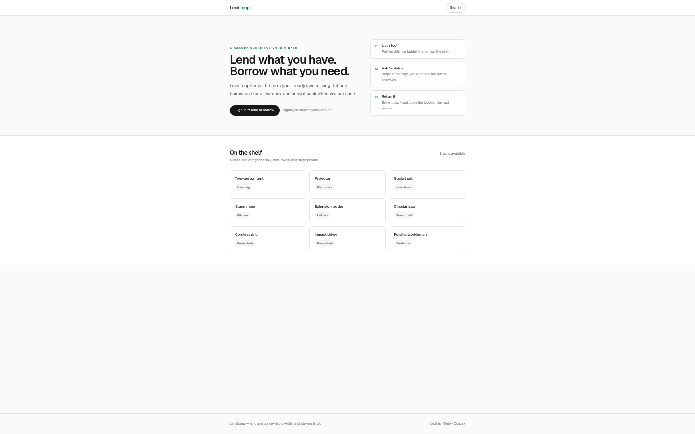
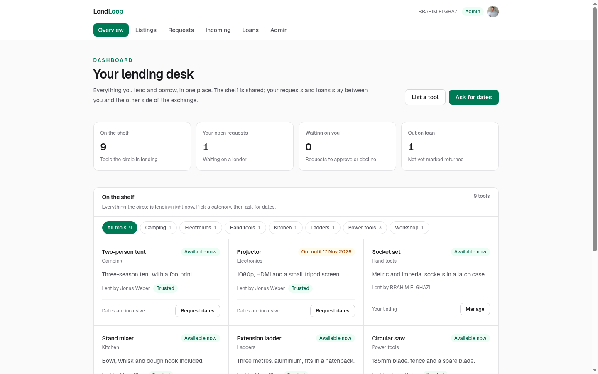
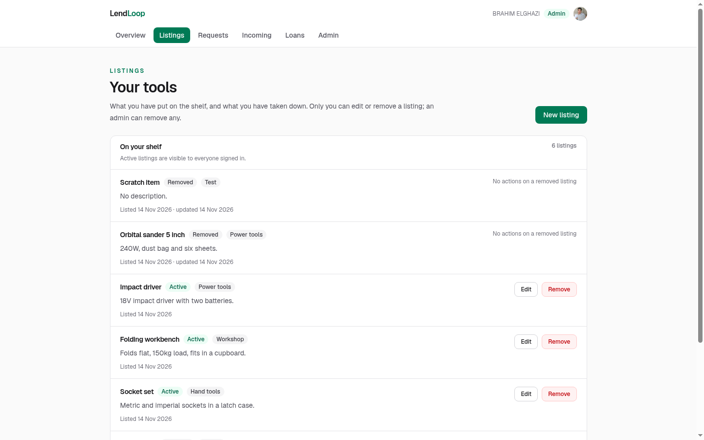
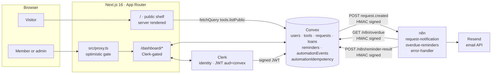

# LendLoop

LendLoop is a shared tool shelf for a trusted circle. One member lists a drill, a ladder or a tent. Another asks for it over a date range. The owner approves or declines, the approved request becomes a loan, and the owner marks it returned when the item comes back.

The app is built with Next.js 16 (App Router), Clerk, Convex and n8n. Three n8n workflows send the request email, send one reminder when a loan becomes overdue, and alert on failures. Every call between Convex and n8n is HMAC signed, and every write-back is idempotent.



## What the three roles can do

| Role | Can do |
|---|---|
| Visitor | See active tool names and categories. Nothing else. |
| Member | List a tool, request one for inclusive dates, cancel a pending request, see their own requests and loans, decide requests for their own tools, and mark a loan they lent as returned. |
| Admin | Everything a member can do, plus remove any listing, see every listing and loan, and mark any lender trusted. |

Membership starts from the database, not from a client claim. `ADMIN_EMAILS` seeds the first admin row; after that the role lives in the `users` table and an admin cannot be promoted by editing a token.

## Screenshots

| Dashboard | Your listings |
|---|---|
|  |  |

## Architecture



The three flows in words:

1. A signed-in browser calls Convex with the Clerk session token. Convex validates the issuer and `aud: "convex"` against `CLERK_JWT_ISSUER_DOMAIN`, loads the user row by token subject, and enforces the rule inside the function.
2. `requests.create` schedules `automation.notifyRequest`. The action loads the request from the database, signs the JSON body, and posts it to the n8n webhook. It never awaits n8n in the request path, so a broken workflow cannot fail a borrower's request. Every attempt is written to `automationEvents`.
3. The daily n8n schedule signs a GET to `/n8n/overdue`, sends one email per newly overdue loan, then signs a POST back to `/n8n/reminder-result`. Convex verifies the signature and the idempotency key before writing.

## Local setup

### Prerequisites

- Node.js 20.9 or newer. Tested on Node 22.
- npm.
- A free Convex account. `npx convex dev` signs in through the browser.
- A Clerk account, or nothing for keyless local development.
- Docker, only if you want the self-hosted n8n option.
- A Resend account and a verified sender, only if you want real email delivery. The signed integration can be tested without it.

### 1. Install dependencies

```bash
npm install
```

### 2. Create the Convex deployment

```bash
npx convex dev
```

The first run opens a browser to log in and creates a development deployment. It writes `CONVEX_DEPLOYMENT`, `NEXT_PUBLIC_CONVEX_URL` and `NEXT_PUBLIC_CONVEX_SITE_URL` to `.env.local`, then tries to push the functions.

That first push stops with:

```text
Environment variable CLERK_JWT_ISSUER_DOMAIN is used in auth config file but its value was not set.
```

This is expected. Clerk does not exist yet, so the issuer cannot be set. The deployment and `.env.local` values are already written. Finish steps 3 and 4, set the issuer, then run `npx convex dev` again.

If you only need one push and no watcher:

```bash
npx convex dev --once
```

### 3. Start the app and let Clerk provision keys

In a second terminal:

```bash
npm run dev
```

Open <http://localhost:3000>. With no Clerk keys present, `@clerk/nextjs` starts in keyless mode, provisions a development application, and writes `NEXT_PUBLIC_CLERK_PUBLISHABLE_KEY` and `CLERK_SECRET_KEY` to `.env.local`. It prints a claim URL. Open that URL and claim the application so the keys keep working.

If the app started before the keys were written, stop it and run `npm run dev` again.

To use your own Clerk application instead, create one, copy its publishable and secret keys into `.env.local`, and restart the dev server.

### 4. Connect Clerk to Convex

In the Clerk dashboard, open **Configure → Convex** (older dashboards call it JWT Templates) and activate the Convex integration. It maps the `aud: "convex"` claim that `convex/auth.config.ts` requires, and it shows the Frontend API URL for your instance.

Convex needs the user's email, because the first sign-in copies it into the `users` row. Confirm the token includes an `email` claim. If your template does not, add:

```json
{ "email": "{{user.primary_email_address}}" }
```

Set the issuer and at least one admin on the Convex deployment:

```bash
npx convex env set CLERK_JWT_ISSUER_DOMAIN https://your-instance.clerk.accounts.dev
npx convex env set ADMIN_EMAILS "you@example.com"
```

`ADMIN_EMAILS` is a comma-separated allowlist. Addresses on it become admin when their user row is first created. The first address is the primary admin.

Run the Convex watcher again so the new auth config reaches the deployment:

```bash
npx convex dev
```

Then sign in once at <http://localhost:3000/sign-in>. `ConvexUserBootstrap` creates the row for the signed-in Clerk user.

### 5. Seed the demo shelf

```bash
npx convex run seed:dev
```

The seed adds two demo lenders and seven tools, including one removed listing so the public filter is visible. Run it a second time after your admin has signed in: that run adds four tools owned by the admin, plus demo requests and loans around that account. The seed is idempotent; a second run does not duplicate rows.

### 6. Check the app

- <http://localhost:3000> shows the shelf while signed out.
- <http://localhost:3000/dashboard> redirects to sign-in while signed out and renders the dashboard after sign-in.
- As the admin, **Admin** in the dashboard header shows every listing and loan.

### 7. Connect n8n

The three workflows are the same JSON in both options. Only the way the secret is stored differs. Use one option.

#### Option A: n8n Cloud

1. Create an n8n instance. The free Pro trial includes Global Variables, which this option needs.
2. In **Variables**, add `N8N_HMAC_SECRET`, `LENDLOOP_CONVEX_SITE_URL`, `LENDLOOP_FROM_EMAIL` and `LENDLOOP_ALERT_EMAIL`. Use the same HMAC value that is on the Convex deployment.
3. In **Credentials**, create a Header Auth credential named `Resend API key` with header `Authorization` and value `Bearer re_...`.
4. Import `n8n/request-notification.json`, `n8n/overdue-reminders.json` and `n8n/error-handler.json`.
5. Open each email node and select the `Resend API key` credential. Credentials are not in the JSON on purpose.
6. On **Request notification** and **Overdue reminders**, open **Settings → Error Workflow** and select **LendLoop · Error handler**.
7. Publish all three workflows, including the error handler. n8n 2.x will not run an inactive error workflow and reports `Workflow ... is not active and cannot be executed`.
8. Copy the production webhook URL for **Request notification**. It looks like `https://<instance>.app.n8n.cloud/webhook/lendloop/request-created`.
9. Set it on the Convex deployment:

```bash
npx convex env set N8N_REQUEST_WEBHOOK_URL "https://<instance>.app.n8n.cloud/webhook/lendloop/request-created"
```

#### Option B: self-hosted n8n with Docker

```bash
cp n8n/.env.example .env
# fill in the required values in .env, then:
docker compose up -d
```

The container serves <http://localhost:5678>. The compose file is pinned to n8n 2.26.3, sets `N8N_BLOCK_ENV_ACCESS_IN_NODE=false` so the Code nodes can read `$env`, and allows the built-in `crypto` module used for HMAC.

After the first start, do the same import and credential steps as Option A, then publish all three workflows. Point Convex at the local webhook:

```bash
npx convex env set N8N_REQUEST_WEBHOOK_URL "http://<host-reachable-from-convex>:5678/webhook/lendloop/request-created"
```

Convex is a hosted service, so `localhost` in that URL means the Convex machine, not your laptop. For a local run, expose the webhook through a tunnel and use the public URL. n8n Cloud does not have this problem.

Once the URL is set, create a request from a non-admin account. The owner should receive the email, and **Convex → Data → automationEvents** should show a delivered outbound event.

### 8. Run the checks

```bash
npm run build            # production build; also generates Next's type helpers
npm run typecheck        # tsc --noEmit
npm run lint             # eslint
npm test                 # vitest, includes convex-test authorization and signature cases

node scripts/mock-n8n-receiver.mjs --self-test
```

Run the build before the first typecheck on a fresh clone: Next generates the `LayoutProps` helper in `.next/types` during a build or a dev run, and `tsc` cannot see it before that. Stop `npm run dev` before `npm run build`, because both write to `.next`.

The self-test starts a throwaway receiver and proves that a genuine signature is accepted, while a tampered body, a stale timestamp, a future timestamp and an unsigned request are rejected. It needs no Convex deployment and no secret.

To check the live signed endpoints on a deployment:

```bash
N8N_HMAC_SECRET="<the deployment secret>" \
  node scripts/mock-n8n-receiver.mjs --convex-site https://<deployment>.convex.site
```

That checks that an unsigned `/n8n/overdue` gets 401, a signed call gets 200, and a replayed reminder-result key returns `duplicate: true` without a second write.

## Environment variables

There are three separate environments. A value in one does not reach the others.

### App: `.env.local`

Read by Next.js and the browser. Clerk keyless mode and `npx convex dev` write most of these for you.

| Variable | Required | Purpose |
|---|---|---|
| `NEXT_PUBLIC_CLERK_PUBLISHABLE_KEY` | Yes | Identifies the Clerk application to the browser and the server SDK. Public by design. |
| `CLERK_SECRET_KEY` | Yes | Server-side key for Clerk. Never exposed to the browser. |
| `NEXT_PUBLIC_CLERK_SIGN_IN_URL` | No | Path of the sign-in page. Set to `/sign-in`. |
| `NEXT_PUBLIC_CLERK_SIGN_UP_URL` | No | Path of the sign-up page. Set to `/sign-up`. |
| `NEXT_PUBLIC_CLERK_SIGN_IN_FALLBACK_REDIRECT_URL` | No | Where a signed-in user lands. Set to `/dashboard`. |
| `NEXT_PUBLIC_CLERK_SIGN_UP_FALLBACK_REDIRECT_URL` | No | Where a newly signed-up user lands. Set to `/dashboard`. |
| `CONVEX_DEPLOYMENT` | Yes, for the CLI | Selects the deployment used by `npx convex` commands. Written by `npx convex dev`. |
| `NEXT_PUBLIC_CONVEX_URL` | Yes | The deployment's HTTP API, used by `ConvexReactClient`. |
| `NEXT_PUBLIC_CONVEX_SITE_URL` | Written by the CLI | Origin of the deployment's HTTP actions. Use its `https://...convex.site` origin as `LENDLOOP_CONVEX_SITE_URL` in n8n. The app does not read it. |
| `N8N_HMAC_SECRET` | No, local tooling only | Used by `scripts/mock-n8n-receiver.mjs` and as the value to copy to Convex and n8n. The Next.js app never reads it. |

### Convex deployment

These live on the Convex deployment, not in a file. Set them with `npx convex env set NAME value` and read them back with `npx convex env list`.

| Variable | Required | Purpose |
|---|---|---|
| `CLERK_JWT_ISSUER_DOMAIN` | Yes | Clerk Frontend API URL, for example `https://verb-noun-00.clerk.accounts.dev`. Read by `convex/auth.config.ts` to accept only that issuer with `aud: "convex"`. A push fails until it is set. |
| `ADMIN_EMAILS` | No, but needed for admin | Comma-separated allowlist. A new user row whose email is on the list is created with `role: "admin"`. |
| `N8N_HMAC_SECRET` | Yes for automation | Shared secret. Signs outbound requests and verifies inbound ones. If it is missing, the signed endpoints return 500 and outbound events fail closed. |
| `N8N_REQUEST_WEBHOOK_URL` | No | Full URL of the request-notification webhook. When empty, the outbound action records a failed event instead of sending. |

### n8n: `.env` for Docker, or Global Variables on Cloud

The Code nodes resolve each setting as `$env.NAME` first and `$vars.NAME` second. Self-hosted n8n reads the environment; Cloud blocks `$env` and falls back to Global Variables. That is why the same workflow JSON runs in both places.

| Variable | Required | Purpose |
|---|---|---|
| `N8N_ENCRYPTION_KEY` | Yes, self-hosted | Encrypts n8n's own credential store. Losing it means re-entering every credential. Generate with `openssl rand -hex 32`. Cloud manages this itself. |
| `N8N_HMAC_SECRET` | Yes | The shared secret. Must equal the value on the Convex deployment. |
| `LENDLOOP_CONVEX_SITE_URL` | Yes | Convex HTTP actions origin, for example `https://<deployment>.convex.site`. Used to build both signed endpoint URLs. |
| `LENDLOOP_FROM_EMAIL` | Yes for email | Verified Resend sender, for example `LendLoop <notifications@example.com>`. |
| `LENDLOOP_ALERT_EMAIL` | Yes for alerts | Recipient of the error workflow's alert. |
| `N8N_HOST`, `N8N_PORT`, `N8N_PROTOCOL`, `N8N_WEBHOOK_URL`, `GENERIC_TIMEZONE` | Self-hosted | Public address n8n advertises and its timezone. Set these to the public https URL behind a tunnel so webhook URLs and execution links resolve. |
| `NODE_FUNCTION_ALLOW_BUILTIN` | Fixed in compose | Set to `crypto` so the Code nodes can HMAC sign. |
| `N8N_BLOCK_ENV_ACCESS_IN_NODE` | Fixed in compose | Set to `false` so self-hosted nodes can read `$env`. n8n 2.x defaults it to `true`. |
| `N8N_SECURE_COOKIE`, `N8N_DIAGNOSTICS_ENABLED`, `N8N_PERSONALIZATION_ENABLED`, `N8N_HIRING_BANNER_ENABLED` | Fixed in compose | Local-only conveniences: http cookies, diagnostics off, banners off. Turn the cookie flag on behind TLS. |

The Resend API key is intentionally not an environment variable. It lives in n8n as the header-auth credential `Resend API key`, so it never appears in the workflow JSON or in this repository.

## Security decisions

### Identity comes from the token, authorization from the database

Every function that acts for a user reads the caller from `ctx.auth.getUserIdentity()`. The lookup key is the verified token subject. No mutation accepts a user id as the identity to act as; an `ownerId` argument is only ever the thing being checked.

Clerk signs the token with `aud: "convex"`, and `convex/auth.config.ts` pins the issuer to `CLERK_JWT_ISSUER_DOMAIN`. A token from another Clerk application is rejected before any function runs.

Roles are not read from the token. The `users.role` column is the source of truth, seeded once from `ADMIN_EMAILS`. A user cannot promote themselves by editing a JWT claim, and an admin demotion is not reverted by the next sign-in.

The rules are enforced inside the function that performs the write, not by hiding a button:

| Entry point | Rule |
|---|---|
| `tools.update`, `tools.remove` | Owner or admin. |
| `requests.approve`, `requests.decline` | Owner of the tool or admin. Re-checked for overlap at approval time, because two pending requests can overlap. |
| `requests.cancel` | Requester or admin, and only while pending. |
| `loans.markReturned` | Lender or admin. Idempotent if already returned. |
| `admin.*` | Admin only, each function separately. |
| `automation.loanActivity` | Borrower, lender or admin for that loan. |
| `loans.overdueForAutomation` | Internal only. A browser cannot call it. |

The Next.js proxy (`src/proxy.ts`) is the optimistic gate: it redirects signed-out visitors away from `/dashboard` before rendering. The dashboard layout repeats `auth()` next to the data, because the check closest to the data is the one that must never be skipped.

### The public endpoint returns two fields

`tools.listPublic` is the only unauthenticated query. Its return validator is exactly:

```ts
{ name: string, category: string }
```

No owner id, email, display name, trusted flag, description or timestamp can leave through it, because the handler never reads them. The public page is a Server Component, so the HTML arrives already rendered from that two-field projection. The query is still callable directly, which is why the projection is enforced by the return validator rather than by the page. Only `status: "active"` rows are returned.

The signed-in shelf does show the owner's display name and whether they are trusted. You need to know who you are asking. That view is behind a session and still omits email addresses.

### HMAC contract

Both directions use the same contract, implemented in `convex/lib/signing.ts` and in the n8n Code nodes:

- Canonical string: `` `${timestamp}.${body}` ``.
- `timestamp`: Unix epoch **milliseconds** as decimal text, 13 digits.
- `body`: the exact request body bytes as UTF-8 text. The empty string for a GET.
- Headers: `x-lendloop-timestamp` and `x-lendloop-signature`.
- Signature: lowercase hex HMAC-SHA256.
- Rejected when the timestamp is more than **five minutes** away from the verifier's clock, in either direction.

The signature covers the timestamp as well as the body. Signing the body alone would leave a captured signature valid forever. Convex reads the raw body with `request.text()` before `JSON.parse`, so the bytes verified are the bytes sent, not a re-serialized object that might order keys differently.

Comparison is constant time. A missing `N8N_HMAC_SECRET` is a 500, never an open door: an unconfigured deployment fails closed. The n8n side does the same check in reverse for every call it receives and every call it makes.

The secret is generated with `openssl rand -hex 32`, which gives 64 hex characters. It exists in three places only: the Convex deployment environment, the n8n environment or Global Variables, and optionally `.env.local` for the local mock receiver. It is never in the workflow JSON, never in Git, and never in a README.

### The replay window

Five minutes is the maximum age of a captured request. A signed request older than that, or one dated more than five minutes in the future, gets `401` with `timestamp_out_of_window`. Both servers need working clocks (NTP); a large clock drift looks exactly like an attack.

The window does not make replay impossible. An attacker who captures a request can resend it within five minutes and the signature still verifies. That is why the write path does not rely on the window alone.

- A replayed `GET /n8n/overdue` only reads data again. It changes nothing.
- A replayed `POST /n8n/reminder-result` is stopped by the idempotency ledger, described next.

### Idempotency

Two kinds of duplicate matter. The write-back is enforced; the outbound notification is traced but not deduped.

**Outbound.** `requests.create` schedules the notification once. The action uses the key `request-notification:<requestId>` in the body and in `x-lendloop-idempotency-key`, so the workflow and its execution log can tie one email to one request. n8n does not keep a separate outbound dedupe ledger: a manually replayed execution would send the email again. The path that must not duplicate is the write-back, and that one is enforced on the Convex side.

**Inbound.** The overdue workflow builds `overdue-reminder:<loanId>:<dueDate>`. The key is deterministic for one loan and one due date, which means one reminder per loan rather than one per day. A second run on a later day reuses the key and writes nothing, and so does a retry of the same run. n8n's workflow static data remembers the same key, so it does not send a second email either.

`automationStore.recordReminderResult` runs as one Convex mutation. In that single transaction it:

1. looks up the key in `automationIdempotency`;
2. returns the first call's `reminderId` and `eventId` with `duplicate: true` if the key exists, writing nothing;
3. otherwise inserts the reminder, inserts the audit event, patches the loan's `lastReminderAt`, and writes the ledger row.

A second guard checks `reminders.by_idempotency_key` for rows written before the ledger existed, and covers two callers that raced past the first read. The response is the same shape either way, so n8n can treat a duplicate as success.

### Data minimisation

The rule is simple: a field that no screen or workflow needs is not sent. This table names the projection for every destination that receives data.

| Destination | Fields | Why |
|---|---|---|
| Anonymous browser, `tools.listPublic` | `name`, `category` | The public shelf. No owner, no description, no dates. |
| Signed-in shelf, `tools.listShelf` | tool `name`, `category`, `description`; owner display `name`; trusted flag; `ownerIsMe`; booked `startDate` and `endDate` pairs | A borrower must know who owns the tool and when it is free. Email stays server-side. |
| Your own account, `users.current` | your `clerkId`, `email`, `name`, `imageUrl`, `role`, `trustedLender`, `createdAt`, `lastSeenAt` | The dashboard header needs your name and role. No other user's row is returned. |
| Your own requests, `requests.listMine` | `toolId`, tool `name` and `category`, `startDate`, `endDate`, `message`, `status`, `createdAt`, `decidedAt` | Your side of the exchange. No other member's identity. |
| Your own loans, `loans.listMine` | `toolId`, tool `name`, `startDate`, `endDate`, `dueDate`, `status`, `overdue`, `returnedAt` | Your side of the exchange. No other member's identity. |
| Your own listings, `tools.listMine`, `tools.get` | `name`, `category`, `description`, `status`, `createdAt`, `updatedAt` | The manage screen. The owner is you, so no owner field is needed. |
| Owner's incoming requests, `requests.listIncoming` | requester `name` and `email`, tool `name`, dates, `message`, status | The owner has to decide and needs a way to reply. |
| Owner's incoming loans, `loans.listIncoming` | borrower `name` and `email`, tool `name`, dates, `dueDate`, status | The lender has to know who holds the item and whether it is late. |
| Admin views, `admin.*` | every user's `email`, `name`, `role` and trusted flag; every listing with owner `email`; every loan with borrower and owner `email` | The admin surface is explicitly the whole board. Each function calls `requireAdmin` first. |
| Loan activity, `automation.loanActivity` | event `kind`, `direction`, `workflow`, `status`, `lastError`, `createdAt` | The borrower, lender or admin sees the reminder history for one loan. |
| Request webhook, Convex → n8n | `event`, `requestId`, `idempotencyKey`, tool `name` and `category`, borrower `name` and `email`, owner `name` and `email`, `startDate`, `endDate`, `message`, `createdAt` | The template uses the tool name, both names, the owner address, the dates and the message. The borrower address is the fallback label when a borrower has no name. The category travels with the event but the current template does not use it. |
| Overdue pull, n8n ← Convex | `asOf`, `count`, and per loan: `loanId`, `toolName`, `borrowerName`, `borrowerEmail`, `ownerName`, `ownerEmail`, `startDate`, `endDate`, `dueDate`, `daysOverdue` | The template uses the tool name, the borrower name and address, the due date, days overdue and the owner name. The owner address travels in the response but the current template does not use it. |
| Reminder write-back, n8n → Convex | `idempotencyKey`, `loanId`, `kind`, `status`, `sentAt`, `error` | The audit trail and the ledger. No free text from the user. |
| Request email, to the owner | borrower `name`, tool `name`, dates, request `message` | The owner needs to decide. The borrower's email is not in the body. |
| Overdue email, to the borrower | borrower `name`, tool `name`, `dueDate`, `daysOverdue`, owner `name` | The nudge, and who to message about an extension. No request message. |
| Error alert, to `LENDLOOP_ALERT_EMAIL` | workflow name, failing node, error message, execution id and URL | Operational alert only. |

Every returned row also carries its Convex `_id`. Document rows returned whole (`users.current`) also carry `_creationTime`. Those are internal identifiers, not profile data.

What the app never collects:

- Passwords. Clerk handles sign-in; the app never sees a credential.
- Payment, billing or subscription data.
- Location, contacts, files or photos. There are no uploads.
- Owner identity on the public page.
- Another member's request data outside the owner and admin views.

Two honest caveats. Tool descriptions and request messages are free text, so a user can type personal information into them. And the reminder and automation audit rows keep the idempotency keys and loan ids indefinitely; a production deployment should add a retention window for `automationIdempotency` and for `automationEvents.payload`.

Two fields also travel without a current consumer: the tool category on the request event and the owner email on the overdue response. Removing them is a one-line change in `convex/automation.ts` and `convex/loans.ts` if you want the payload to match the templates exactly.

## Tests and what they prove

`npm test` runs Vitest with `convex-test`. The suite covers:

- a non-owner cannot edit, delete or decide, and admin variants pass;
- `listPublic` returns exactly `name` and `category`;
- overlapping bookings are refused, including at approval time;
- overdue returns only past-due, unreturned loans;
- the signature verifier accepts a genuine signature and rejects a tampered body, a stale timestamp, a future timestamp and an unsigned request;
- one idempotency key writes one reminder and one event, and a replay writes nothing;
- the outbound action records a failed event when the webhook is missing or returns an error.

`node scripts/mock-n8n-receiver.mjs --self-test` repeats the signature checks against a real HTTP server, outside Convex. It is the quickest way to see the contract work.

## What would change in production

This app runs on managed development services. A production deployment on AWS would replace each one, and the table below says what changes. The authorization rules, the public projection, the HMAC contract, the five-minute window and the idempotency keys stay the same; the code that implements them moves.

| Concern | Here | On AWS | What changes |
|---|---|---|---|
| Next.js hosting | `next start` on a laptop or a small VM | **ECS** Fargate behind an Application Load Balancer, or **Lambda** with a Next.js adapter | Build a container image or a Lambda bundle. No `.env.local`: task definition environment and Secrets Manager. Add an ALB health check, autoscaling and a CloudFront distribution in front. |
| Identity | Clerk | **Cognito** user pool | Replace `ClerkProvider`, the Clerk middleware and the Clerk hooks with Cognito's hosted UI or Amplify Auth. The JWT issuer becomes the user pool. `CLERK_JWT_ISSUER_DOMAIN` becomes the pool's issuer URL. Keep the `users.role` column as the app's authorization source, even if Cognito groups mirror it. |
| Data | Convex | **RDS** for PostgreSQL, Aurora Serverless v2, in private subnets | Replace `defineSchema` and Convex functions with migrations and SQL. Each authorization check becomes a service-layer guard in the same transaction as the write. The idempotency ledger becomes a `unique` constraint plus an insert-or-return-existing. Realtime subscriptions need a separate channel (WebSocket or polling); Convex gives them for free today. Use RDS Proxy for connection pooling. |
| Files and assets | None | **S3** with CloudFront | Static assets and database exports go to a private bucket with Origin Access Control. If tool photos are added later, upload with presigned URLs and keep the bucket private. No user files exist today. |
| Audit | `automationEvents` | **CloudTrail** plus the application table | Enable a multi-region trail with log-file validation, deliver to S3 and CloudWatch. CloudTrail records AWS API calls, not app actions, so keep `automationEvents` for request, reminder and approval history. Add RDS audit logs if the compliance scope needs row-level reads. |
| Automation | n8n workflows | EventBridge Scheduler plus Lambda, SES for email | The daily sweep becomes a scheduled Lambda. Request notifications go through a queue with a dead-letter queue. Keep the same idempotency keys. Inside AWS, IAM roles and SigV4 can authenticate the caller, so the shared secret can go; keep HMAC if n8n stays external. |
| Secrets | `.env` and n8n variables | Secrets Manager and KMS | No secret in a task definition or an image. Rotate the HMAC secret and the Resend key on a schedule. Rotating the HMAC secret needs both sides updated together, or a key id in the header. |
| Observability | Console logs | CloudWatch Logs, metrics, alarms and X-Ray | Structured JSON logs, an alarm on signed-endpoint 401 spikes and on failed automation events, and traces across the API and the worker. |
| Network | localhost | VPC, private subnets, security groups, WAF | RDS accepts traffic only from the app security group. The ALB is the only public entry point. WAF rate-limits `/sign-in` and the public page. |
| Delivery | None | GitHub Actions, ECR, ECS deploy | Build, scan and push the image, run migrations as a one-off task, then deploy with a circuit breaker and rollback. |

Two things I would do before calling it production ready, beyond the service swap: add rate limiting to the public Convex query and the signed endpoints, and add an account deletion path so a user can remove their row, requests and loans. Neither exists today, and both are cheap to add once the data layer is SQL.

## Repository layout

| Path | What is in it |
|---|---|
| `src/app` | Public page, sign-in and sign-up, dashboard routes. |
| `src/components` | Public shelf, dashboard screens, shared UI. |
| `src/proxy.ts` | Clerk's Next.js 16 proxy: dashboard gate and signed-in redirect from `/`. |
| `convex/schema.ts` | Seven tables: users, tools, requests, loans, reminders, automationEvents, automationIdempotency. |
| `convex/tools.ts`, `requests.ts`, `loans.ts`, `admin.ts` | Domain functions with authorization inside each one. |
| `convex/automation.ts`, `automationStore.ts` | Outbound signing, the signed endpoints' storage layer, and the idempotency ledger. |
| `convex/http.ts` | `GET /n8n/overdue` and `POST /n8n/reminder-result`. |
| `convex/lib/signing.ts` | The HMAC contract in one place. |
| `n8n/*.json` | Three importable workflows. No secrets inside. |
| `scripts/mock-n8n-receiver.mjs` | Reference receiver, self-test and live endpoint check. |
| `docker-compose.yml` | Self-hosted n8n. |
| `.env.example`, `n8n/.env.example` | Blank templates. No real values. |

## Known limits

- Email delivery needs a verified Resend sender. `example.com` recipients are rejected by Resend, so the seeded demo lenders cannot receive mail. Use two real addresses to see the full loop.
- Without `N8N_REQUEST_WEBHOOK_URL`, requests still work; the outbound event is recorded as failed. That is deliberate, so a missing automation never blocks the app.
- The n8n Cloud trial is a trial. The compose file is the permanent fallback.
- There is no account deletion or data export screen yet.
- The public query has no rate limit. It is cheap, but it is still an unauthenticated endpoint.
