# LendLoop application guide

Revision 2, 17 November 2026: the Convex review fixes (overdue sweep, bookable-range rules, return validators, bounded reads, index cleanup, automation retention, seed confirmation). Uncommitted working-tree changes on top of commit `b7d0b69` (`b7d0b69530b180a5000f2072bff2aec27c44f48c`), the tip of `main` when revision 1 was written. Every claim below was checked against that tree: the code, the schema, the tests, the three n8n workflow files and the two env templates. Where the code and the README disagree, the code wins and the difference is recorded in section 20.4.

This is an internal engineering handbook, not a sales page. It assumes you can read TypeScript and have used a web app. It does not assume you built LendLoop.

## Contents

1. [Read this first](#1-read-this-first)
2. [Product](#2-product)
3. [System context](#3-system-context)
4. [One action end to end](#4-one-action-end-to-end)
5. [Stack and why](#5-stack-and-why)
6. [Repository map](#6-repository-map)
7. [Data model](#7-data-model)
8. [Convex backend](#8-convex-backend)
9. [State machines and rules](#9-state-machines-and-rules)
10. [Frontend](#10-frontend)
11. [Automation](#11-automation)
12. [Security](#12-security)
13. [Configuration and environments](#13-configuration-and-environments)
14. [Running it](#14-running-it)
15. [Testing](#15-testing)
16. [Operations and troubleshooting](#16-operations-and-troubleshooting)
17. [How to change it](#17-how-to-change-it)
18. [Interview walkthrough](#18-interview-walkthrough)
19. [Glossary and command cheat sheet](#19-glossary-and-command-cheat-sheet)
20. [Appendix](#20-appendix)

## 1. Read this first

LendLoop is a shared tool shelf for a trusted circle. One person lists a drill, a ladder or a tent. Another asks for it over a range of days. The owner approves or declines. Approval creates a loan. The owner marks it returned when the item comes back. Everything else in the product exists to make that loop safe, visible and lightly automated.

The one-paragraph pitch: LendLoop gives a small group a private catalogue of the things they already own, a dated request-and-approval flow instead of a group chat, and a loan ledger that knows what is out and what is late. It sends the owner one email when a request arrives and the borrower one email when a loan goes overdue, and every automated call between the app and the workflow engine is signed and replay-resistant.

### The five-minute mental model

1. **Clerk proves who you are.** The browser holds a Clerk session. Clerk signs a JWT with `aud: "convex"` and an email claim. Convex validates the issuer, then looks up a `users` row by the token subject.
2. **Convex holds the data and the rules.** There is no separate API server. Queries and mutations are the API, and each one enforces its own authorization in the same transaction as the read or write. The `users.role` column, not the token, decides who is an admin.
3. **The UI is a set of reactive subscriptions.** The dashboard components call `useQuery` and re-render when the underlying rows change. The public page is the exception: it is a Server Component that fetches once per request.
4. **Automation runs out of band.** Creating a request writes the row, then schedules an action. That action signs a JSON body and posts it to n8n. The borrower's request never waits for n8n, and a broken workflow cannot fail it.
5. **n8n comes back through a signed door.** n8n has no Clerk identity, so it calls two HTTP actions on the Convex site origin, signed with a shared HMAC secret. Convex verifies the signature, the five-minute timestamp window and, for writes, an idempotency key before touching the database.

### How to use the rest of this guide

- For an interview, read sections 1, 2, 4, 7, 9, 11, 12 and 18.
- To debug, read section 16 first, then the module page in section 8 that owns the failing function.
- To change something, read section 17. Each recipe names every file to touch and the check to run.
- To understand a single identifier, use section 19.3.

Two labels appear throughout. "Code fact" means the statement is directly visible in the cited file. "Design choice" means the code could reasonably have gone another way, and the reason given is an inference from the code and its comments, not a requirement.

## 2. Product

### The problem

A group of neighbours, friends or colleagues already owns the tools each of them occasionally needs. The hard part is not finding a drill. It is coordinating who has it, for which days, and when it is due back, without losing the answer in a chat thread. LendLoop replaces that thread with a small ledger: a listing, a dated request, a decision, a loan, a return.

### The three roles

| Role | How you get it | What you can do |
|---|---|---|
| Visitor | No session | Read the public shelf: tool name and category only. |
| Member | Sign in with Clerk. The first call to `users.store` creates the row. | List tools, request another member's tool for inclusive dates, cancel a pending request, see their own requests and loans, decide requests for their own tools, mark their own loans returned. |
| Admin | A `users` row with `role: "admin"`, seeded once from `ADMIN_EMAILS`. | Everything a member can do, plus remove any listing, read every listing, loan and account, mark any lender trusted, and read the board-wide automation feed. |

Membership and role come from the database. A client cannot promote itself by editing a JWT claim, and a later sign-in does not overwrite a role that an operator changed. The seeding rule is in `convex/lib/roles.ts` and the enforcement is in `convex/lib/authz.ts`.

### The core loop

1. A member lists a tool. It is `active` and appears on the signed-in shelf immediately.
2. Another member picks a start and end date and sends a request. The dates are inclusive on both ends.
3. The tool's owner sees the request in Incoming and approves or declines it. Approval re-checks availability, then inserts a loan whose `dueDate` is the request's `endDate`.
4. The owner hands over the item in person. There is no shipping, deposit or handover record.
5. When the item comes back, the owner marks the loan returned. The dates become bookable again, even if the original range had not finished.

### What is deliberately out of scope

The code has no payments, deposits, insurance, delivery, in-app chat, photo uploads, ratings, waitlists, recurring loans, calendar sync, notification preferences, account deletion, data export, organisation tenancy, or admin user promotion. The public shelf searches only by name and category. A "trusted lender" is a badge an admin sets, not a score computed from history. These are product cuts, not missing plumbing: there are no tables, routes or functions waiting behind a flag.

### The demo's seeded state

`npx convex run seed:dev '{"confirm":"seed-demo-data"}'` runs an internal mutation (`convex/seed.ts`). The `confirm` argument is required, so a seed against the wrong deployment is never an accident; without it the mutation throws `SEED_NOT_CONFIRMED` with the exact command. On a fresh deployment it inserts two demo lenders and seven tools. The two seeded lenders are `maya.chen@example.com` (trusted) and `jonas.weber@example.com`, both with `clerkId` values prefixed `seed_`, both `role: "user"`. The seven tools are Cordless drill, Circular saw, Extension ladder, Two-person tent, Stand mixer, Projector and Lawn mower, which is seeded with `status: "removed"` so the public filter has something to exclude.

A second run, after a real admin has signed in, adds activity around that admin: four tools owned by the admin (Impact driver, Folding workbench, Socket set, and a removed Lawn edger), five requests the admin made, and five requests for the admin's tools. Five of those ten requests are approved, so the seed creates five loans, two of them already returned. The mutation returns `{ seeded, tools, demo, demoLoans }`; after both phases on an empty database that is `tools: 11` and `demoLoans: 5`. It is idempotent: the base phase is skipped when the marker user exists, and the activity phase is skipped when the admin already has any incoming or outgoing request.

The seeded addresses are on `example.com`, which Resend rejects. The seed exists to fill screens, not to deliver mail.

## 3. System context

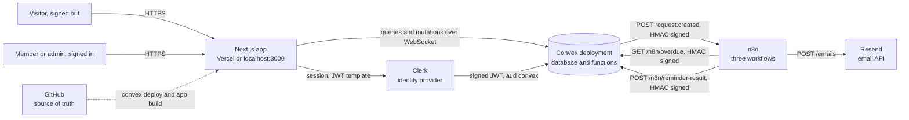

**Figure 1. System context.** Reading: people reach one Next.js app; that app talks to Clerk for identity and to Convex for data; only Convex and n8n talk to each other, in both directions, always signed.

The system has six containers that matter:

| Container | What runs there | What it talks to | Direction |
|---|---|---|---|
| Browser | React 19 client components, the Clerk session, one `ConvexReactClient` per tab | Next.js over HTTPS, Clerk over HTTPS, Convex over WebSocket | Outbound |
| Next.js 16.4.6 | App Router pages, the Clerk proxy, the public Server Component | Clerk (server SDK), Convex (HTTP `fetchQuery` for the public page), the browser | Both |
| Clerk | Hosted sign-in, session cookies, the `convex` JWT template | Browser, Next.js, and indirectly Convex through the token | Both |
| Convex | Seven tables, 36 exported functions, two HTTP actions, two daily crons, the scheduler | Clerk (JWKS for token verification), n8n (signed HTTP), the browser | Both |
| n8n | Request notification, overdue reminders, error handler | Convex (signed HTTP), Resend | Both |
| Resend | Email delivery | n8n | Inbound from n8n |

The call directions are worth memorising because they explain the security model:

- The browser never calls n8n and never sees the HMAC secret.
- n8n never calls the Convex function API. It calls only the two HTTP routes under `/n8n/`.
- Convex calls n8n only from the scheduled action `automation.notifyRequest`.
- Clerk is the only source of identity. Convex reads no user id from a function argument.

### Where it runs

Locally, `next dev` serves port 3000, `npx convex dev` points the app at a development deployment, and n8n runs either in Docker on port 5678 or on Cloud. In the demo, Vercel serves the same Next.js build, Convex functions live on a production deployment, and n8n Cloud runs the published workflows. The README records the live demo at `lendloop-eta.vercel.app`, and states that it uses a Clerk development instance, so the sign-in card carries a Development mode badge and any email address can create a member account.

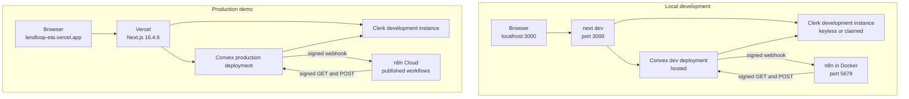

**Figure 2. Deployment view.** Reading: the same code runs in both columns; only the hosting and the n8n runtime change. The signed contract is identical.

There is no message queue, no cache tier, no object store and no separate worker process. Convex's scheduler is the only background job runner on the app side, and n8n's schedule trigger is the only timer on the automation side. That is a deliberate small-system trade-off: fewer moving parts, and the failure modes are visible in two tables (`automationEvents` and the n8n execution log).

## 4. One action end to end

This is the path a signed-in member takes when they request a tool. The identifiers are the real ones from the code.

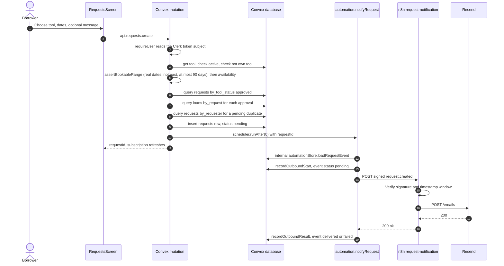

**Figure 3. Request creation and notification.** Reading: the request commits before any network call to n8n; the notification is a separate, traced step that cannot fail the request.

### Step by step

1. `src/components/dashboard/RequestsScreen.tsx` renders a form. It loads the shelf with `useQuery(api.tools.listShelf)`, filters out the caller's own tools, and skips the availability query until a tool and two valid dates exist.
2. Submit calls `create({ toolId, startDate, endDate, message })`. The Convex React client attaches the Clerk session token. `ConvexClientProvider` wires `ConvexProviderWithClerk` to the `convex` JWT template.
3. Convex verifies the token against `CLERK_JWT_ISSUER_DOMAIN` and requires `aud: "convex"`, as configured in `convex/auth.config.ts`. A token from another Clerk application is rejected before the handler runs.
4. `requests.create` calls `requireUser` (`convex/lib/authz.ts`). That calls `ctx.auth.getUserIdentity()`, takes `identity.subject`, and looks up `users` through `by_clerk_id`. No argument can substitute for this.
5. The handler loads the tool with `ctx.db.get(args.toolId)`. Missing or `status: "removed"` throws `TOOL_NOT_AVAILABLE`. `tool.ownerId === user._id` throws `OWN_TOOL`.
6. `assertBookableRange` (`convex/lib/dates.ts`) requires two real `YYYY-MM-DD` dates with `startDate <= endDate`, a start today or later, and an inclusive range of at most 90 days, otherwise `INVALID_DATE_RANGE`.
7. `findApprovedConflicts` (`convex/lib/availability.ts`) reads `requests` through `by_tool_status` for this tool and `approved`, skips the request being decided, tests inclusive overlap, and loads the matching loan through `loans.by_request`. A returned loan does not block, while an `overdue` loan blocks every future date.
8. A conflict throws `TOOL_UNAVAILABLE`. A second `pending` request from the same borrower, overlapping the same tool, throws `ALREADY_REQUESTED`.
9. The handler inserts the request with `status: "pending"`, `requesterId` from the token, `ownerId` copied from the tool, `createdAt: Date.now()` and the trimmed optional message.
10. `ctx.scheduler.runAfter(0, internal.automation.notifyRequest, { requestId })` schedules the notification. The mutation does not await it.
11. The mutation returns the new id. Every mounted `useQuery(api.requests.listMine)`, `api.requests.listIncoming` and `api.tools.listShelf` subscription updates from the committed write. The borrower sees the request in Pending; the owner sees it in Incoming and the header count.
12. The scheduler runs `automation.notifyRequest` (`convex/automation.ts`). It calls `internal.automationStore.loadRequestEvent`, which reads the request, its tool, its owner and its borrower, and returns a flat event object with fallbacks (`"Removed tool"`, `"Removed"`, empty string for a missing email).
13. The action builds the body: `event: "request.created"`, `requestId`, `idempotencyKey: "request-notification:<requestId>"`, `tool { name, category }`, `borrower { name, email }`, `owner { name, email }`, `startDate`, `endDate`, `message`, `createdAt`.
14. It writes `automationEvents` with `recordOutboundStart`: direction `outbound`, workflow `request-notification`, status `pending`, payload is the exact JSON body. This happens before the network call, so a crash leaves a trace.
15. It reads `N8N_REQUEST_WEBHOOK_URL` and `N8N_HMAC_SECRET`. If either is missing, it records a failed event with a sentence naming the missing variable. Otherwise it signs `${timestamp}.${body}` with HMAC-SHA256, lower-case hex, and posts with `x-lendloop-timestamp`, `x-lendloop-signature` and `x-lendloop-idempotency-key`.
16. The n8n workflow `LendLoop · Request notification` receives the raw body at webhook path `lendloop/request-created`. Its `Verify signature` Code node rebuilds the HMAC over the exact raw bytes, checks the 13-digit millisecond timestamp, rejects anything more than five minutes away, compares with `crypto.timingSafeEqual`, then parses the JSON.
17. A valid signature reaches `Signature valid?`, then `Build notification`, then `Send email` to the owner through Resend, then `Respond 200`. An invalid one reaches `Respond 401` with a `reason`.
18. Back in the action, a non-2xx status or a thrown network error becomes `lastError` (truncated to 500 characters). `recordOutboundResult` patches the event to `delivered` or `failed` and stores the error. The action returns `{ eventId, delivered, lastError }`.
19. An admin sees the row in the Automation panel, which reads `api.automation.recentActivity`. A failed row names the workflow and the error.

### What happens when n8n is down

The request is already committed. The action records a failed event and returns. There is no retry on the Convex side and no queue: `requests.create` schedules the action once, and the n8n workflow runs once when the webhook arrives. A missing webhook URL is treated the same way, deliberately, so a half-configured deployment still lets members borrow. To resend, you either fix the URL and replay from the n8n execution log or call `internal.automation.notifyRequest` again from the CLI or a one-off function. A retry needs an outbox table and a scheduled worker; neither exists today.

### Why the order matters

The scheduler runs only after the mutation's transaction commits. That is why the action can read the request by id and always find it. It is also why n8n can never observe a half-written request, and why the borrower's UI does not wait for email delivery. The cost is that the outbound event and the request are not atomic: a request can exist with a failed notification, and that is the intended trade-off.

## 5. Stack and why

| Package | `package.json` range | Installed at `b7d0b69` | Why it is here |
|---|---|---|---|
| `next` | `16.4.6` (exact) | 16.4.6 | App Router, Server Components, the `proxy.ts` request gate, `cacheComponents` and `partialPrefetching`. Exact pin because Next minor releases change build behaviour. |
| `react`, `react-dom` | `19.3.0` (exact) | 19.3.0 | Required by Next 16. Server Components and the client hooks the dashboard uses. |
| `convex` | `^1.50.0` | 1.50.0 | Database, functions, realtime subscriptions, scheduler and HTTP actions in one service. |
| `@clerk/nextjs` | `^7.10.0` | 7.10.0 | Hosted sign-in, session handling, the `convex` JWT template, `UserButton`. |
| `tailwindcss` | `4.3.3` (exact) | 4.3.3 | CSS-first tokens. There is no `tailwind.config` file; tokens live in `globals.css` under `@theme inline`. |
| `@tailwindcss/turbopack` | `4.3.3` (exact) | 4.3.3 | Wires Tailwind into Turbopack through the `next.config.ts` CSS rule. |
| `typescript` | `^5` | 5.9.3 | Strict type checking, including Convex's generated types. |
| `vitest` | `^5.1.0` | 5.1.0 | Test runner for `convex-test` and the theme unit tests. |
| `convex-test` | `^0.0.71` | 0.0.71 | Runs the real Convex functions in-process against an in-memory database. |
| `eslint` | `^9` | 9.39.5 | Lint, using the Next core-web-vitals and TypeScript presets. |
| `eslint-config-next` | `16.4.6` (exact) | 16.4.6 | Next's lint rules, pinned to the framework version. |
| n8n | image `n8nio/n8n:2.26.3` | 2.26.3 in Docker | Workflow engine for the three automations. Cloud runs the same JSON. |
| Resend | HTTP API, no SDK | n/a | Email. The API key lives in an n8n credential, not in this repo. |

Node 20.9 or newer is required; the README says it was tested on Node 22. There is no ORM, no API framework, no state manager, no component library, no date library and no email SDK. Every dependency in the list earns its place, and the rest is the platform.

### The Next.js 16 details that surprise people

- **`src/proxy.ts` is the new middleware.** Starting with Next 16, Middleware is called Proxy. The file sits at `src/proxy.ts`, next to `src/app`, and exports `clerkMiddleware(...)` plus a `config.matcher`. There is no `middleware.ts` in this tree. Functionally it is still a request-time gate, not an authorization layer.
- **`cacheComponents: true` and `partialPrefetching: true`** are both set in `next.config.ts`. Together they enable the cache and instant-navigation model the `instant` segment config belongs to.
- **`export const instant = false`** appears on the home page and every dashboard route. It opts the segment out of instant-navigation validation, because these routes intentionally block on a session read or a Convex subscription. It only has meaning while `cacheComponents` is on.
- **`await connection()`** in `SiteHeader` and `PublicToolList` marks those components as request-time. Without it, Next would try to prerender a shell that calls Convex during the build.
- **`LayoutProps<"/">`** in `src/app/layout.tsx` is a generated global type. It comes from `.next/types`, which is why the README says to run `npm run build` before the first `npm run typecheck` on a fresh clone.
- **`allowedDevOrigins: ["127.0.0.1"]`** lets the agent browser load dev resources from `127.0.0.1` while the dev server advertises `localhost`. It is a development-only convenience.

## 6. Repository map

```text
lendloop/
├── AGENTS.md                     Next.js agent rules, rewritten by next dev
├── README.md                     the reviewer-facing document
├── package.json                  scripts and dependency ranges
├── package-lock.json             exact resolved tree
├── next.config.ts                cacheComponents, partialPrefetching, Turbopack CSS
├── tsconfig.json                 strict TS, "@/*" -> "./src/*"
├── tsconfig.tsbuildinfo          generated by tsc, gitignored
├── next-env.d.ts                 generated by Next, gitignored
├── eslint.config.mjs             flat config, ignores convex/_generated
├── vitest.config.mts             node environment, convex and tests globs
├── docker-compose.yml            self-hosted n8n 2.26.3
├── .env.example                  app and CLI variable template, no values
├── .env.local                    local values only, gitignored
├── .gitignore                    env files, .next, .vercel, .clerk, tsbuildinfo
├── .clerk/                       keyless provisioning state, gitignored
├── .vercel/                      CLI link state, gitignored
├── .next/                        build output, gitignored
├── convex/
│   ├── schema.ts                 seven tables, validators, 20 indexes
│   ├── auth.config.ts            Clerk issuer and aud
│   ├── users.ts                  store, current
│   ├── tools.ts                  public shelf, signed shelf, own listings, availability
│   ├── requests.ts               create, list, approve, decline, cancel
│   ├── loans.ts                  markReturned, markOverdue, lists, overdue, internal overdue
│   ├── admin.ts                  users, trust, all tools, all loans
│   ├── automation.ts             outbound action, admin feed, per-loan feed
│   ├── automationStore.ts        internal reads and writes for the boundary
│   ├── maintenance.ts            internal pruneAutomation retention job
│   ├── crons.ts                  two daily cron registrations
│   ├── http.ts                   GET /n8n/overdue, POST /n8n/reminder-result
│   ├── seed.ts                   internalMutation dev, confirm-guarded
│   ├── lib/                      auth, authz, availability, dates, fixtures,
│   │                             roles, signing, users, validation
│   ├── *.test.ts                 six convex-test suites
│   ├── _generated/               generated by the Convex CLI, never edited
│   ├── README.md                 the Convex scaffold README, not project docs
│   └── tsconfig.json             Convex's own TS settings
├── src/
│   ├── proxy.ts                  Clerk proxy: dashboard gate
│   ├── app/
│   │   ├── layout.tsx            providers, fonts, theme boot script
│   │   ├── page.tsx              public landing page, seven bands
│   │   ├── globals.css           tokens, @theme mapping, container rules
│   │   ├── icon.svg              favicon
│   │   ├── apple-icon.png        apple touch icon
│   │   ├── sign-in/[[...sign-in]]/page.tsx
│   │   ├── sign-up/[[...sign-up]]/page.tsx
│   │   └── dashboard/
│   │       ├── layout.tsx        server auth check and shell
│   │       ├── page.tsx          overview
│   │       ├── loading.tsx       segment skeleton
│   │       ├── error.tsx         segment error boundary
│   │       ├── admin/page.tsx
│   │       ├── incoming/page.tsx
│   │       ├── listings/page.tsx
│   │       ├── loans/page.tsx
│   │       └── requests/page.tsx
│   ├── components/
│   │   ├── BrandMark.tsx         the two-ring mark
│   │   ├── ConvexClientProvider.tsx
│   │   ├── ConvexUserBootstrap.tsx
│   │   ├── PublicToolList.tsx    server-rendered public shelf
│   │   ├── SignInCta.tsx         modal sign-in button
│   │   ├── ui.tsx                Badge, Button, Field, Section, Skeleton, Banner
│   │   ├── dashboard/            one screen per route plus the shell and shelf
│   │   ├── landing/              header, hero, shelf card, steps, why, CTA, footer
│   │   └── theme/                ThemeProvider, ThemeSwitcher
│   └── lib/
│       ├── convex-error.ts       ConvexError to one sentence
│       ├── format.ts             date and range formatting, due labels
│       ├── theme.ts              storage key, resolution, boot script
│       └── use-action.ts         pending key, error, notice per panel
├── n8n/
│   ├── request-notification.json
│   ├── overdue-reminders.json
│   ├── error-handler.json
│   └── .env.example              n8n variables, no values
├── scripts/
│   └── mock-n8n-receiver.mjs     reference receiver, self-test, live check
├── tests/
│   └── theme.test.ts             theme values and the boot script
├── public/
│   ├── images/                   three landing photographs
│   └── *.svg                     starter icons
└── docs/
    ├── APP-GUIDE.md              this file
    ├── design/                   token source, redesign spec, photo brief
    ├── screenshots/              design audit and baseline captures
    └── incoming/                 untracked reference images, not part of the build
```

What belongs where:

- A schema change goes in `convex/schema.ts` and nowhere else. A rule goes in the function that performs the write, and only moves into `convex/lib/` when two callers need the same rule.
- Presentation belongs in `src/components` and `src/app`. Components never re-implement a rule as a disabled button; they surface the server's sentence.
- Anything n8n calls must be an HTTP route in `convex/http.ts` backed by an internal function. n8n never gets a public Convex function reference.
- Generated trees are `convex/_generated`, `.next`, `next-env.d.ts`, `tsconfig.tsbuildinfo`, `.clerk` and `.vercel`. Do not hand-edit them. `convex/README.md` is the scaffold text Convex writes into a new functions directory; the project's own backend notes are the file-level comments.

## 7. Data model

The schema is one file, `convex/schema.ts`. It declares seven tables and 20 indexes. Every document also carries Convex's implicit `_id` (a typed document id) and `_creationTime` (epoch milliseconds); they are omitted from the tables below because no code declares them.

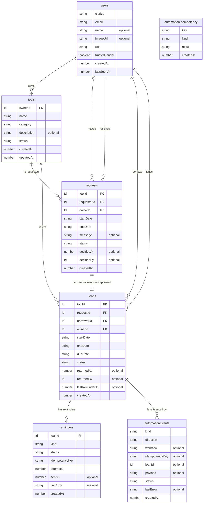

**Figure 4. Entity relationships.** Reading: `users` own tools, send and receive requests, and sit on both sides of a loan; a request becomes at most one loan; a loan has reminders and audit events. `automationIdempotency` is deliberately unrelated: its `result` column stores the ids of the rows the first call created.

Convex does not enforce foreign keys. The `v.id("table")` validators make a reference type-safe, but nothing stops a referenced row from being deleted. LendLoop never hard-deletes a user, tool, request or loan, so the references stay resolvable in practice. Section 7.8 lists the relationship rules that the code enforces instead.

### 7.1 users

One row per signed-in Clerk user. Created on the first call to `users.store`, refreshed on later calls.

| Field | Type | Optional | Why it exists |
|---|---|---|---|
| `clerkId` | `string` | No | The verified token subject. Every authorization lookup starts here. |
| `email` | `string` | No | Copied from the verified token, lower-cased. Shown to the owner who must decide a request, and to admins. |
| `name` | `string` | Yes | Display name from Clerk. The UI falls back to the email. |
| `imageUrl` | `string` | Yes | Clerk avatar URL. Stored but not rendered by any current screen. |
| `role` | `"admin" \| "user"` | No | The authorization source of truth. Seeded once from `ADMIN_EMAILS`; never refreshed from the token. |
| `trustedLender` | `boolean` | No | A badge an admin sets. Defaults to `false` on insert. |
| `createdAt` | `number` | No | Epoch milliseconds, set on insert. |
| `lastSeenAt` | `number` | No | Epoch milliseconds, refreshed by every `users.store` call. |

Indexes:

| Index | Keys | Used by | Note |
|---|---|---|---|
| `by_clerk_id` | `clerkId` | `users.store`, `users.current`, `requireUser`, `seed.ts` | The hot path. `.unique()` is used, so two rows with one subject would throw. |
| `by_role` | `role` | `seed.ts` | Finds the first admin for the activity phase. |

The row is the app's identity record, not a profile editor. `name`, `imageUrl` and `email` follow Clerk on each `users.store`; `role` and `trustedLender` do not. That split is in `profilePatch` in `convex/lib/users.ts` and is the reason an allowlist edit cannot demote an existing admin.

### 7.2 tools

A lendable item.

| Field | Type | Optional | Why it exists |
|---|---|---|---|
| `ownerId` | `Id<"users">` | No | The lender. Set from the token user on create, never from an argument. |
| `name` | `string` | No | Trimmed, 1 to 80 characters. |
| `category` | `string` | No | Trimmed, 1 to 40 characters. Free text; the form suggests eight common values. |
| `description` | `string` | Yes | Trimmed, up to 500 characters. An empty string from the form is stored as absent. |
| `status` | `"active" \| "removed"` | No | Soft delete. Only `active` rows appear on either shelf. |
| `createdAt` | `number` | No | Epoch milliseconds. |
| `updatedAt` | `number` | No | Epoch milliseconds. Patched on every `tools.update` and on removal. |

Indexes:

| Index | Keys | Used by | Note |
|---|---|---|---|
| `by_owner` | `ownerId` | `tools.listMine`, `seed.ts` | The own-listings screen. |
| `by_status` | `status` | `tools.listPublic`, `tools.listShelf` | Both shelves filter to `active`. |

Removal is soft because requests and loans point at the tool. A removed tool keeps its name for history, drops out of the shelves, and cannot be edited (`TOOL_REMOVED`). `admin.removeTool` performs the same patch without ownership.

### 7.3 requests

A borrower's ask for a tool over an inclusive date range.

| Field | Type | Optional | Why it exists |
|---|---|---|---|
| `toolId` | `Id<"tools">` | No | What is being asked for. |
| `requesterId` | `Id<"users">` | No | The borrower, from the token. |
| `ownerId` | `Id<"users">` | No | Denormalised from the tool at creation. The decision mutations authorize from this column without reading the tool, and it cannot drift because tool ownership never changes. |
| `startDate` | `string` | No | `YYYY-MM-DD`, inclusive. |
| `endDate` | `string` | No | `YYYY-MM-DD`, inclusive. |
| `message` | `string` | Yes | Trimmed, up to 500 characters. Free text, shown to the owner. |
| `status` | `"pending" \| "approved" \| "declined" \| "cancelled"` | No | The request state machine. |
| `decidedAt` | `number` | Yes | Epoch milliseconds of approval, decline or cancellation. |
| `decidedBy` | `Id<"users">` | Yes | Who decided. For a cancellation this is the requester, or an admin acting on it. |
| `createdAt` | `number` | No | Epoch milliseconds. |

Indexes:

| Index | Keys | Used by | Note |
|---|---|---|---|
| `by_requester` | `requesterId` | `requests.listMine`, `requests.create` duplicate check, `seed.ts` | The borrower's view and the duplicate guard. |
| `by_owner` | `ownerId` | `requests.listIncoming`, `seed.ts` | The owner's inbox. |
| `by_tool_status` | `toolId`, `status` | `findApprovedConflicts` | The reservation ledger read, always with `status: "approved"`. |
| `by_owner_status` | `ownerId`, `status` | No current reader | Kept for a pending-only inbox; the current inbox reads all the owner's requests. |

The request is the reservation ledger. `pending`, `declined` and `cancelled` never block a date; `approved` blocks it until its loan is returned.

### 7.4 loans

An approved request turned into an actual loan.

| Field | Type | Optional | Why it exists |
|---|---|---|---|
| `toolId` | `Id<"tools">` | No | Copied from the request. |
| `requestId` | `Id<"requests">` | No | The approval that created it. Used by `findApprovedConflicts` to find the loan for an approved request. |
| `borrowerId` | `Id<"users">` | No | Copied from `request.requesterId`. |
| `ownerId` | `Id<"users">` | No | The lender. Only this user, or an admin, can close the loan. |
| `startDate` | `string` | No | `YYYY-MM-DD`, inclusive. |
| `endDate` | `string` | No | `YYYY-MM-DD`, inclusive. |
| `dueDate` | `string` | No | `YYYY-MM-DD`. Set to `endDate` on creation. Drives lateness. |
| `status` | `"active" \| "overdue" \| "returned"` | No | Stored loan state. `requests.approve` inserts `active`; the daily `loans.markOverdue` cron flips a past-due `active` row to `overdue`; `loans.markReturned` writes `returned`. |
| `returnedAt` | `number` | Yes | Epoch milliseconds of the return confirmation. |
| `returnedBy` | `Id<"users">` | Yes | The lender or admin who confirmed it. |
| `lastReminderAt` | `number` | Yes | Epoch milliseconds of the last reminder the automation reported as sent. |
| `createdAt` | `number` | No | Epoch milliseconds. |

Indexes:

| Index | Keys | Used by | Note |
|---|---|---|---|
| `by_borrower` | `borrowerId` | `loans.listMine` | The borrower's side. |
| `by_owner` | `ownerId` | `loans.listIncoming` | The lender's side. |
| `by_status` | `status` | `admin.listLoans` when a status filter is passed | The admin table. |
| `by_status_due` | `status`, `dueDate` | `loans.markOverdue`, `collectOverdue` | The sweep reads `active` rows with `dueDate < today`; the collector reads both open statuses with `dueDate < asOf`. |
| `by_request` | `requestId` | `findApprovedConflicts` | One loan per request in practice. `.unique()` is used. |

`status` is the stored overdue flag, and the daily sweep keeps it current: `loans.markOverdue` flips every `active` loan whose `dueDate < today` to `overdue`. The list views (`loans.listMine`, `loans.listIncoming`, `admin.listLoans`) report `overdue` from that stored value, so they never read the wall clock. The shelf returns every unreturned approved booking, and the client labels a booking whose end date has passed as overdue. The reminder feed (`loans.overdue`, `loans.overdueForAutomation`) still computes lateness from `dueDate`, so a loan is reported the moment it is late even if the sweep has not run. A returned loan is never late. The sweep runs daily at 00:05 UTC and is bounded to 1000 rows per run; a larger backlog is caught up over successive days.

### 7.5 reminders

One row per reminder outcome the automation reports. The table is an outcome ledger, not a queue.

| Field | Type | Optional | Why it exists |
|---|---|---|---|
| `loanId` | `Id<"loans">` | No | Which loan the reminder was about. |
| `kind` | `"due_soon" \| "overdue"` | No | The schema allows both. Only `overdue` is sent today. |
| `status` | `"pending" \| "sent" \| "failed"` | No | The outcome. `pending` is never written. |
| `idempotencyKey` | `string` | No | Supplied by n8n. The second replay guard reads it. |
| `attempts` | `number` | No | Count of prior reminders for the same loan and kind, plus one. |
| `sentAt` | `number` | Yes | Epoch milliseconds, from n8n when status is `sent`, otherwise absent. |
| `lastError` | `string` | Yes | Up to 500 characters, when status is `failed`. |
| `createdAt` | `number` | No | Epoch milliseconds. |

Indexes:

| Index | Keys | Used by | Note |
|---|---|---|---|
| `by_loan` | `loanId` | `recordReminderResult` | Reads prior rows to compute `attempts`. |
| `by_idempotency_key` | `idempotencyKey` | `recordReminderResult` second guard | Covers rows written before the ledger existed and a race past the ledger read. |

`attempts` counts rows of the same `kind` for the loan, not rows with the same key. A second key for the same loan and kind produces `attempts: 2`, which `convex/automation.test.ts` asserts.

### 7.6 automationEvents

The audit trail for both directions of the automation boundary.

| Field | Type | Optional | Why it exists |
|---|---|---|---|
| `kind` | `string` | No | Free-form event name: `request.created`, `reminder.sent`, `reminder.failed`. |
| `direction` | `"outbound" \| "inbound"` | No | Which way the call went. |
| `workflow` | `string` | Yes | `request-notification` or `overdue-reminders`. |
| `idempotencyKey` | `string` | Yes | The key used for the call. |
| `loanId` | `Id<"loans">` | Yes | Set on inbound reminder events, so the per-loan feed can find them. Outbound request events have no loan yet. |
| `payload` | `string` | Yes | JSON string. Outbound: the exact request body, which includes both email addresses. Inbound: a summary of the reminder. No secret is ever written. |
| `status` | `"pending" \| "delivered" \| "failed" \| "ignored"` | No | `pending` is written before the outbound call; the result patch moves it to `delivered` or `failed`. `ignored` is never written. |
| `lastError` | `string` | Yes | The failure sentence, up to 500 characters. |
| `createdAt` | `number` | No | Epoch milliseconds. |

Indexes:

| Index | Keys | Used by | Note |
|---|---|---|---|
| `by_created` | `createdAt` | `automation.recentActivity`, `maintenance.pruneAutomation` | Board-wide feed, newest first; retention reads by age. |
| `by_status_created` | `status`, `createdAt` | `maintenance.pruneAutomation` | Finds outbound rows left `pending` by a dead action. |
| `by_loan_created` | `loanId`, `createdAt` | `automation.loanActivity` | One loan's events, newest first. |

An outbound row is inserted as `pending` before `fetch`. If the action is killed between the insert and `recordOutboundResult`, the row stays `pending` until the daily retention job flips it to `failed` with "No result was recorded within an hour." Rows older than 90 days are deleted, so the table keeps a season rather than every event ever written.

### 7.7 automationIdempotency

The generic replay ledger for inbound automation writes.

| Field | Type | Optional | Why it exists |
|---|---|---|---|
| `key` | `string` | No | The caller's idempotency key, trimmed, 1 to 200 characters. |
| `kind` | `string` | No | `reminder-result` is the only value written today. Reserved for future inbound calls. |
| `result` | `string` | No | JSON of the first call's `{ reminderId, eventId }`, so a retry gets the original outcome. |
| `createdAt` | `number` | No | Epoch milliseconds. |

Index:

| Index | Keys | Used by | Note |
|---|---|---|---|
| `by_key` | `key` | `recordReminderResult` | `.unique()`, then a duplicate returns the stored result. |
| `by_created` | `createdAt` | `maintenance.pruneAutomation` | Deletes keys older than the 7-day retry horizon. |

There is no relation to `automationEvents` because the ledger stores ids as JSON, not as typed references. The row is written in the same mutation as the reminder and the event, so the ledger can never claim a success that was not stored.

### 7.8 Conventions and relationships

| Convention | Rule | Why |
|---|---|---|
| Calendar dates | `startDate`, `endDate`, `dueDate` are ISO `YYYY-MM-DD` strings. | A loan is a whole-day range. Lexicographic comparison of that format is chronological, so overlap and past-due tests compare strings without parsing or time zones. |
| Instants | `createdAt`, `decidedAt`, `returnedAt`, `lastSeenAt`, `lastReminderAt`, `sentAt` are epoch milliseconds. | Ordering and display, independent of calendar days. |
| Inclusive ranges | A range from the 10th to the 12th covers three days, and the next free start is the 13th. | `rangesOverlap` uses `aStart <= bEnd && bStart <= aEnd`. |
| Denormalised owner | `requests.ownerId` is copied from the tool. | The decision mutation can authorize from the request alone. Safe because a tool never changes owner. |
| Soft delete | Tools move to `status: "removed"`; nothing is deleted. | Old requests and loans keep a resolvable `toolId`, and history keeps the tool name. |
| No hard delete of domain rows | No function deletes a user, tool, request, loan or reminder. The one deleter is `maintenance.pruneAutomation`, which removes expired automation bookkeeping only. | Avoids orphaned references in a schema that cannot enforce them; the retention ledger has no referrers. |
| Typed references | `v.id("table")` gives a typed id, not a foreign key. | Convex does not enforce existence; the app's no-delete rule supplies that guarantee. |
| Idempotency ledger | One row per inbound key, holding the first result. | A retried n8n run returns the original ids and writes nothing. |

Relationship rules the code actually enforces:

| Relationship | Cardinality | Enforced where |
|---|---|---|
| `users` to `tools` | One owner, many tools | `tools.create` sets `ownerId` from the token. No transfer function exists. |
| `tools` to `requests` | One tool, many requests | `requests.create` loads the tool and copies its owner. |
| `requests` to `loans` | At most one loan per request | `requests.approve` inserts a loan only when the request is `pending`; `by_request` is read with `.unique()`. |
| `loans` to `reminders` | One loan, many reminder outcomes | `recordReminderResult` inserts one row per accepted key. |
| `loans` to `automationEvents` | One loan, many events | Inbound events set `loanId`; the per-loan feed reads `by_loan_created`. |
| `automationIdempotency` to anything | None | It stores ids in JSON by design, to stay generic. |

### 7.9 Index inventory

All 20 declared indexes, with the reader that uses each one. Nineteen have a reader in code; `requests.by_owner_status` is kept for a pending-only inbox that does not exist yet.

| Table | Index | Keys | Reader |
|---|---|---|---|
| `users` | `by_clerk_id` | `clerkId` | `findByClerkId`, `seed.ts` |
| `users` | `by_role` | `role` | `seed.ts` |
| `tools` | `by_owner` | `ownerId` | `tools.listMine`, `seed.ts` |
| `tools` | `by_status` | `status` | `tools.listPublic`, `tools.listShelf` |
| `requests` | `by_requester` | `requesterId` | `requests.listMine`, `requests.create`, `seed.ts` |
| `requests` | `by_owner` | `ownerId` | `requests.listIncoming`, `seed.ts` |
| `requests` | `by_tool_status` | `toolId`, `status` | `findApprovedConflicts` |
| `requests` | `by_owner_status` | `ownerId`, `status` | No current reader |
| `loans` | `by_borrower` | `borrowerId` | `loans.listMine` |
| `loans` | `by_owner` | `ownerId` | `loans.listIncoming` |
| `loans` | `by_status` | `status` | `admin.listLoans` |
| `loans` | `by_status_due` | `status`, `dueDate` | `loans.markOverdue`, `collectOverdue` |
| `loans` | `by_request` | `requestId` | `findApprovedConflicts` |
| `reminders` | `by_loan` | `loanId` | `recordReminderResult` |
| `reminders` | `by_idempotency_key` | `idempotencyKey` | `recordReminderResult` |
| `automationEvents` | `by_created` | `createdAt` | `automation.recentActivity`, `maintenance.pruneAutomation` |
| `automationEvents` | `by_status_created` | `status`, `createdAt` | `maintenance.pruneAutomation` |
| `automationEvents` | `by_loan_created` | `loanId`, `createdAt` | `automation.loanActivity` |
| `automationIdempotency` | `by_key` | `key` | `recordReminderResult` |
| `automationIdempotency` | `by_created` | `createdAt` | `maintenance.pruneAutomation` |

Indexes are not free: each one adds a write cost and a storage cost. The review that produced revision 2 removed nine indexes with no reader and added two that the retention job needs. If you add a query, prefer an existing index whose prefix matches; if you add an index, add the query in the same change.

## 8. Convex backend

Convex loads every module under `convex/`; only exports declared with `query`, `mutation`, `action`, `internalQuery`, `internalMutation`, `internalAction` or `httpAction` become callable functions. The `lib/` modules export helpers, so they are deployed code but not functions. A function is registered by its exported name and file path, so `convex/requests.ts` with `export const create` becomes `api.requests.create` for the browser and `internal.requests.create` internally. `npx convex dev` regenerates `convex/_generated/api.d.ts` from those exports; that generated file is how the frontend gets typed function references.

Auth levels used in the catalog:

- **Anonymous**: no token required.
- **Signed-in**: a valid Clerk token whose subject has a `users` row. A token without a row gets `USER_NOT_SYNCED`.
- **Owner**: signed-in, and the caller's `users._id` equals the resource's `ownerId`.
- **Admin**: signed-in, and `users.role === "admin"`.
- **Internal**: not reachable from a browser. No auth check is needed because only another Convex function, the scheduler or the CLI can call it.

### 8.1 Function catalog

| Export | File | Kind | Auth | Inputs | Returns | Purpose |
|---|---|---|---|---|---|---|
| `users.store` | `convex/users.ts` | mutation | Signed-in token, row created if absent | none | `Id<"users">` | Create or refresh the caller's row; seed `role` from `ADMIN_EMAILS` only on insert. |
| `users.current` | `convex/users.ts` | query | Anonymous (null when signed out) | none | `{ _id, email, name, imageUrl, role, trustedLender, createdAt, lastSeenAt }` or `null` | The caller's own row, without `clerkId`. |
| `tools.listPublic` | `convex/tools.ts` | query | Anonymous | none | `{ name, category }[]` | Active tools, exactly two fields. |
| `tools.listShelf` | `convex/tools.ts` | query | Signed-in | none | `{ _id, name, category, description, ownerName, ownerTrusted, ownerIsMe, bookings[] }[]` | The signed-in shelf, with owner display and approved bookings. |
| `tools.listMine` | `convex/tools.ts` | query | Signed-in | none | `{ _id, name, category, description, status, createdAt, updatedAt }[]` | The caller's listings, newest first. |
| `tools.get` | `convex/tools.ts` | query | Owner or admin | `{ toolId }` | same tool view as `listMine` | One listing. |
| `tools.availability` | `convex/tools.ts` | query | Signed-in | `{ toolId, startDate, endDate }` | `{ available: boolean, conflicts: { startDate, endDate }[] }` | Whether a range is free, and what blocks it. |
| `tools.create` | `convex/tools.ts` | mutation | Signed-in | `{ name, category, description? }` | `Id<"tools">` | Insert an `active` listing owned by the caller. |
| `tools.update` | `convex/tools.ts` | mutation | Owner or admin | `{ toolId, name?, category?, description? }` | `Id<"tools">` | Patch a listing; a removed listing is refused. |
| `tools.remove` | `convex/tools.ts` | mutation | Owner or admin | `{ toolId }` | `Id<"tools">` | Soft delete. |
| `requests.create` | `convex/requests.ts` | mutation | Signed-in, not the owner | `{ toolId, startDate, endDate, message? }` | `Id<"requests">` | Insert a pending request and schedule the notification. |
| `requests.listMine` | `convex/requests.ts` | query | Signed-in | none | `{ _id, toolId, toolName, toolCategory, startDate, endDate, message, status, createdAt, decidedAt }[]` | Requests the caller made. |
| `requests.listIncoming` | `convex/requests.ts` | query | Signed-in | none | same shape plus `requesterName` and `requesterEmail` | Requests for the caller's tools. |
| `requests.approve` | `convex/requests.ts` | mutation | Request owner or admin | `{ requestId }` | `Id<"requests">` | Re-check availability, insert the loan, mark approved. |
| `requests.decline` | `convex/requests.ts` | mutation | Request owner or admin | `{ requestId }` | `Id<"requests">` | Mark declined; no loan. |
| `requests.cancel` | `convex/requests.ts` | mutation | Requester or admin | `{ requestId }` | `Id<"requests">` | Cancel a pending request. |
| `loans.markReturned` | `convex/loans.ts` | mutation | Lender or admin | `{ loanId }` | `Id<"loans">` | Set returned; idempotent. |
| `loans.markOverdue` | `convex/loans.ts` | internalMutation | Internal (cron) | none | `number` | Flip past-due `active` loans to `overdue`; returns the count. |
| `loans.listMine` | `convex/loans.ts` | query | Signed-in | none | `{ _id, toolId, toolName, startDate, endDate, dueDate, status, overdue, returnedAt }[]` | Loans the caller borrowed. |
| `loans.listIncoming` | `convex/loans.ts` | query | Signed-in | none | same shape plus `borrowerName` and `borrowerEmail` | Loans of the caller's tools. |
| `loans.overdue` | `convex/loans.ts` | query | Admin | `{ asOf }` | overdue view array | Every past-due, unreturned loan as of `asOf`. |
| `loans.overdueForAutomation` | `convex/loans.ts` | internalQuery | Internal | `{ asOf }` | overdue view array | The same list for the signed endpoint. |
| `admin.listUsers` | `convex/admin.ts` | query | Admin | none | `{ _id, email, name, role, trustedLender, createdAt }[]` | Every account, no `clerkId`. |
| `admin.setTrustedLender` | `convex/admin.ts` | mutation | Admin | `{ userId, trusted }` | `Id<"users">` | Set or clear the trust badge. |
| `admin.listTools` | `convex/admin.ts` | query | Admin | none | tool view plus `ownerName`, `ownerEmail` | Every listing, removed included. |
| `admin.removeTool` | `convex/admin.ts` | mutation | Admin | `{ toolId }` | `Id<"tools">` | Soft delete any listing. |
| `admin.listLoans` | `convex/admin.ts` | query | Admin | `{ status? }` | loan view plus both emails | Every loan, optionally by stored status. |
| `automation.notifyRequest` | `convex/automation.ts` | internalAction | Internal | `{ requestId }` | `{ eventId, delivered, lastError }` | Sign and POST `request.created` to n8n. |
| `automation.recentActivity` | `convex/automation.ts` | query | Admin | `{ limit? }` | event view array | Board-wide automation feed. |
| `automation.loanActivity` | `convex/automation.ts` | query | Borrower, lender or admin | `{ loanId }` | event view array | One loan's automation feed. |
| `automationStore.loadRequestEvent` | `convex/automationStore.ts` | internalQuery | Internal | `{ requestId }` | event object or `null` | Flatten a request for the notification body. |
| `automationStore.recordOutboundStart` | `convex/automationStore.ts` | internalMutation | Internal | `{ kind, workflow, idempotencyKey, payload }` | `Id<"automationEvents">` | Insert the `pending` outbound row. |
| `automationStore.recordOutboundResult` | `convex/automationStore.ts` | internalMutation | Internal | `{ eventId, lastError }` | `null` | Close the row as `delivered` or `failed`. |
| `automationStore.recordReminderResult` | `convex/automationStore.ts` | internalMutation | Internal | `{ idempotencyKey, loanId, kind, status, sentAt?, error? }` | `{ duplicate, reminderId, eventId, code }` | Idempotent reminder write-back. |
| `maintenance.pruneAutomation` | `convex/maintenance.ts` | internalMutation | Internal (cron) | none | `{ prunedIdempotency, markedStale, prunedEvents }` | Retention: prune the ledger and old events, close stale pending rows. |
| `seed.dev` | `convex/seed.ts` | internalMutation | Internal (CLI) | `{ confirm? }` | `{ seeded, tools, demo, demoLoans }` | Idempotent demo data; requires `confirm: "seed-demo-data"`. |

Count: 36 exported functions in 9 files, plus the cron registry in `convex/crons.ts`, so 10 backend modules carry the API. Two are `internalQuery` (`loans.overdueForAutomation` and `automationStore.loadRequestEvent`), six are `internalMutation` (`recordOutboundStart`, `recordOutboundResult`, `recordReminderResult`, `loans.markOverdue`, `maintenance.pruneAutomation` and `seed.dev`), one is an `internalAction` (`automation.notifyRequest`), and the remaining 27 are public functions reachable from the browser with the auth level shown. The exact grep used to confirm this is in section 20.3.

### 8.2 users

`convex/users.ts` is a thin file over `convex/lib/users.ts`.

Rules:

- `store` requires a verified identity. It looks up by `identity.subject`. On insert it requires an email claim, otherwise `EMAIL_MISSING` with a message telling you to add `email` to the Clerk JWT template.
- On insert it sets `clerkId`, lower-cased `email`, optional `name` and `imageUrl`, `role: roleForNewUser(email)`, `trustedLender: false`, and both timestamps.
- On a later call it patches only `email`, `name`, `imageUrl` when they differ, plus `lastSeenAt` every time. It never patches `role` or `trustedLender`. `profilePatch` is the function to read before changing this.
- `current` calls `ctx.auth.getUserIdentity()` directly and returns `null` when there is no identity. It does not throw, because the dashboard shell uses it while the session is still loading. It returns a projection without `clerkId`: `_id`, `email`, `name`, `imageUrl`, `role`, `trustedLender`, `createdAt`, `lastSeenAt`. The code comment in `convex/users.ts` records why `identity.subject` is kept rather than migrating to `tokenIdentifier`.

Non-obvious logic: the bootstrap runs in the root layout, so `lastSeenAt` is written on every full page load. That is a small cost accepted for a simple "the row exists before any page queries it" guarantee. `DashboardShell` also calls `store` once if `users.current` is still `null`, to cover the race where a dashboard page mounts before the root bootstrap finishes.

Errors: `UNAUTHENTICATED`, `EMAIL_MISSING`, `USER_WRITE_FAILED`.

### 8.3 tools

Rules:

- `listPublic` is the only function that returns data without a session. It queries `by_status` for `active` (at most 500 rows) and maps to exactly `{ name, category }`. The return validator also declares exactly those two fields, so a later change that returns more would fail validation rather than leak silently.
- `listShelf` requires a user, reads at most 200 active tools, loads each owner, and calls `findApprovedConflicts` over `0000-01-01` to `9999-12-31` to get every approved booking that still stands. That includes a past booking whose loan has not been returned, which the client shows as overdue. It returns `ownerIsMe`, `ownerTrusted`, and only the booking dates. It sorts by category then name.
- `listMine` reads `by_owner` newest first through `.order("desc").take(200)`. It includes removed rows on purpose: the manage screen must show what you took down.
- `get` throws `TOOL_NOT_FOUND` before authorizing, then `requireOwnerOrAdmin`.
- `listMine` and `get` share the `toolViewValidator` return shape.
- `availability` requires a user, validates the range, rejects a missing or removed tool with `TOOL_NOT_AVAILABLE`, and returns the conflicts as date pairs.
- `create` trims and bounds `name` (80), `category` (40) and `description` (500). An empty description becomes absent.
- `update` authorizes first, refuses a removed tool (`TOOL_REMOVED`), and patches only the fields supplied. It always patches `updatedAt`, even if the payload only contains `toolId`.
- `remove` is idempotent: it patches only when the row is `active`.

Non-obvious logic: both shelf reads go through `findApprovedConflicts`, which is an N+1 read pattern (one query per approved request, plus one loan read per overlap). The approved read is capped to the newest 200 rows, newest first, because recent approvals are the ones that can still block. That is fine for a small circle and is the first thing to change at scale, because the shelf read grows with approvals per tool.

Errors: `UNAUTHENTICATED`, `USER_NOT_SYNCED`, `FORBIDDEN`, `TOOL_NOT_FOUND`, `TOOL_REMOVED`, `TOOL_NOT_AVAILABLE`, `INVALID_ARGUMENT`, `INVALID_DATE_RANGE`.

### 8.4 requests

Rules:

- `create` is the most guarded mutation in the app. In order: signed-in user, tool exists and is active, not your own tool, bookable range (real inclusive dates, start today or later, at most 90 days), no approved overlap, no overlapping pending request from the same borrower. The duplicate guard reads the borrower's newest 200 requests, because a pending duplicate is recent. Then it inserts and schedules.
- `listMine` reads `by_requester` newest first through `.order("desc").take(200)`, and resolves the tool name and category per row. A missing tool becomes `"Removed tool"` and `"Removed"`.
- `listIncoming` reads `by_owner` the same way and resolves the requester. This is one of two member-facing functions that return another user's email, alongside `loans.listIncoming`, and only to the owner of the requested tool.
- Both list functions declare a `returns` validator; `listIncoming` extends the base request view with `requesterName` and `requesterEmail`.
- `approve` loads the request, requires the caller to equal `request.ownerId` or be an admin, requires `pending`, re-runs availability while excluding this request, inserts the loan with `dueDate: request.endDate`, then patches the request to `approved` with `decidedAt` and `decidedBy`.
- `decline` has the same authorization and pending check, patches to `declined`, and creates nothing.
- `cancel` authorizes against `request.requesterId` (requester or admin), requires `pending`, and patches to `cancelled` with the canceller in `decidedBy`.

Non-obvious logic: approval re-checks availability because two overlapping requests can both be pending. The first approval wins; the second gets `TOOL_UNAVAILABLE` and stays pending. The check excludes the request being approved, otherwise its own approved row would block it if the mutation were retried.

Errors: `UNAUTHENTICATED`, `USER_NOT_SYNCED`, `TOOL_NOT_AVAILABLE`, `OWN_TOOL`, `INVALID_DATE_RANGE`, `TOOL_UNAVAILABLE`, `ALREADY_REQUESTED`, `REQUEST_NOT_FOUND`, `FORBIDDEN`, `ALREADY_DECIDED`.

### 8.5 loans

Rules:

- `markReturned` loads the loan, requires the caller to equal `loan.ownerId` or be an admin, and returns the id unchanged when the loan is already `returned`. Otherwise it patches `status`, `returnedAt` and `returnedBy`.
- `markOverdue` is the internal sweep: it reads `active` rows whose `dueDate < today` through `by_status_due` (at most 1000), patches each to `overdue`, and returns the count. It never touches a returned loan.
- `listMine` and `listIncoming` read by borrower and owner, newest first through `.order("desc").take(200)`, resolve the tool and the other party, and report `overdue` from the stored status. They declare `returns` validators.
- `overdue` requires an admin and calls `collectOverdue` with the required `asOf`.
- `overdueForAutomation` is internal and calls the same collector with the same required `asOf`, because the HTTP action has already verified the HMAC signature.

Non-obvious logic in `collectOverdue`: it queries `by_status_due` twice, once for `active` and once for `overdue`, each with `.lt("dueDate", asOf)`. It then filters out any row with a `returnedAt`, which handles a row whose status lags its return timestamp. It sorts by `dueDate` and computes `daysOverdue` with `daysBetween(dueDate, asOf)`. An invalid `asOf` throws `INVALID_ARGUMENT`; there is no default, so no handler reads the clock.

Errors: `LOAN_NOT_FOUND`, `UNAUTHENTICATED`, `USER_NOT_SYNCED`, `FORBIDDEN`, `INVALID_ARGUMENT`.

### 8.6 admin

`convex/admin.ts` holds the only functions that read or change data the caller does not own. Each calls `requireAdmin` first, as its own entry point, so widening a normal mutation cannot reach admin behaviour.

Rules:

- `listUsers` reads the newest 500 users (`.order("desc").take(500)`) and sorts them by email. It returns `_id`, `email`, `name`, `role`, `trustedLender`, `createdAt`; it deliberately omits `clerkId` and `imageUrl`.
- `setTrustedLender` checks that the target exists (`USER_NOT_FOUND`) and patches the boolean. The call is not deduplicated: it patches even when the value is unchanged, and the resulting state is the same.
- `listTools` reads the newest 500 tools, and resolves owner name and email. Removed rows are included.
- `removeTool` is the same soft delete as `tools.remove`, without the ownership check.
- `listLoans` reads at most 500 loans, all or one status through `by_status`, and resolves tool, borrower and owner. It reports `overdue` from the stored status, not from `dueDate`.
- All three list queries declare `returns` validators.

Non-obvious logic: the admin UI calls `api.admin.listLoans` with `{}`, so it shows every loan; the optional `status` argument exists for a filtered view that the current UI does not expose.

Errors: `UNAUTHENTICATED`, `USER_NOT_SYNCED`, `FORBIDDEN`, `USER_NOT_FOUND`, `TOOL_NOT_FOUND`.

### 8.7 automation

Rules:

- `notifyRequest` is an internal action. It reads the event through `loadRequestEvent`, builds the deterministic key, records the attempt, then tries the network call. Missing configuration is recorded as a failure, not thrown.
- `recentActivity` requires an admin and clamps `limit` to 1 through 50, default 12. It reads `by_created` descending and returns a projection without `payload` or `idempotencyKey`.
- `loanActivity` requires a signed-in user, loads the loan (`LOAN_NOT_FOUND` if missing), and allows only the borrower, the lender or an admin. It reads `by_loan_created` descending with `.take(100)` and returns the same projection as `recentActivity`.

Non-obvious logic: the action throws `REQUEST_NOT_FOUND` if the request disappeared between scheduling and execution. That branch writes no event, because there is nothing to attach it to; the failure is visible in the Convex logs. The action's return value is not stored anywhere; the audit row is the durable record.

Errors: `REQUEST_NOT_FOUND`, `LOAN_NOT_FOUND`, `UNAUTHENTICATED`, `USER_NOT_SYNCED`, `FORBIDDEN`.

### 8.8 automationStore

This module exists so `automation.ts` can call database functions through `internal.automationStore.*` without a circular type reference. All four are internal.

Rules:

- `loadRequestEvent` returns `null` for a missing request, and otherwise flattens request, tool, owner and borrower with the same fallbacks the UI uses.
- `recordOutboundStart` always inserts `direction: "outbound"`, `status: "pending"` and the payload string.
- `recordOutboundResult` throws `EVENT_NOT_FOUND` if the row vanished, then patches `status` and `lastError`. A `null` error means delivered.
- `recordReminderResult` is the critical path. It trims and bounds the key, checks the ledger by key, checks the reminder table by key, normalizes the loan id, inserts the reminder, inserts the inbound event, patches `loan.lastReminderAt` on success, and inserts the ledger row, all in one mutation.

Non-obvious logic:

- The ledger is checked before the reminder table. A hit returns the stored `{ reminderId, eventId }` parsed from JSON; malformed JSON degrades to `null` ids rather than throwing.
- The second guard returns `duplicate: true` with `eventId: null` for a reminder written before the ledger existed. n8n treats both shapes as success.
- `ctx.db.normalizeId("loans", args.loanId)` turns the string from the HTTP body into a typed id, or `null` for a malformed value. Both malformed and missing produce `LOAN_NOT_FOUND`, which the route maps to 404.
- `attempts` is computed from prior rows of the same `kind` for the loan, so a retry with a new key increments it.
- `sentAt` is used only when `status` is `sent`; a failed row has no `sentAt` and does not touch `lastReminderAt`. A future `sentAt` is clamped to the mutation's own clock, so a reminder cannot claim to have been sent later than it was recorded.
- The error text for a failed reminder is trimmed, defaults to `"n8n reported the reminder as failed."` when blank, and is capped at 500 characters.

Errors: `EVENT_NOT_FOUND`, plus the returned codes `INVALID_IDEMPOTENCY_KEY` and `LOAN_NOT_FOUND`.

### 8.9 http

`convex/http.ts` registers two routes on the deployment's `.convex.site` origin. Both call `authorize(request, body)` before doing anything else.

Rules:

- A missing `N8N_HMAC_SECRET` returns 500 `{ error: "not_configured" }`. It never falls open.
- A failed signature check returns 401 `{ error: "unauthorized", reason }` with the verifier's reason.
- `GET /n8n/overdue` reads the body as text (empty for a GET), verifies, calls `internal.loans.overdueForAutomation` with today's UTC date, and returns `{ asOf, count, loans }` with `cache-control: no-store`.
- `POST /n8n/reminder-result` reads the raw text, verifies, parses JSON (`400 invalid_json`), shape-validates (`400 invalid_payload` with a message), calls `recordReminderResult`, maps `LOAN_NOT_FOUND` to 404 and any other returned code to 400, and otherwise returns `{ ok: true, duplicate, reminderId, eventId }`.

Non-obvious logic: the body is read as text before `JSON.parse` because the signature covers the exact bytes sent. Re-serializing would let key order or whitespace change the bytes and break a valid signature. `parseReminderResult` validates types before the mutation so a bad payload is a 400 the workflow can branch on, not a 500 from a Convex validator.

### 8.10 seed

`seed.dev` is an internal mutation, so only the CLI or another function can call it. Because the CLI can point at production, it requires `confirm: "seed-demo-data"`; without it the mutation throws `SEED_NOT_CONFIRMED` and writes nothing. It is two phases:

- Base: if the marker user `seed_maya_chen` is absent, insert Maya, Jonas, and seven tools.
- Activity: find the first user with `role: "admin"`. If none, return `{ created: false, loans: 0 }`. If the admin already has any incoming or outgoing request, skip. Otherwise insert four admin tools, ten requests and five loans, using relative dates from `isoDay(offset)`.

Non-obvious logic: the activity phase deliberately checks for any admin request rather than a marker, so a second run after the admin has used the app does nothing. The seed writes directly with `ctx.db.insert`, which also proves the schema accepts the shapes. The returned `tools` count is the total in the table, read with `.take(1000)`, not the number inserted, and `toolByName` reads at most 200 of an owner's listings.

### 8.11 Error code inventory

Every `ConvexError` code in the backend, with its usual cause. The client shows the `message`, not the code, through `src/lib/convex-error.ts`.

| Code | Thrown by | Meaning |
|---|---|---|
| `UNAUTHENTICATED` | `requireIdentity` | No valid Clerk token. |
| `USER_NOT_SYNCED` | `requireUser` | Token is valid but no `users` row exists yet. |
| `EMAIL_MISSING` | `getOrCreateUser` | The JWT has no `email` claim, so the row cannot be created. |
| `USER_WRITE_FAILED` | `getOrCreateUser` | The inserted row could not be read back. |
| `FORBIDDEN` | `requireAdmin`, `requireOwnerOrAdmin`, `loanActivity` | The caller is not the owner, requester, lender or admin for this action. |
| `USER_NOT_FOUND` | `admin.setTrustedLender` | The target user id does not exist. |
| `TOOL_NOT_FOUND` | tool reads and writes, `admin.removeTool` | No such tool. |
| `TOOL_REMOVED` | `tools.update` | A removed listing cannot be edited. |
| `TOOL_NOT_AVAILABLE` | `requests.create`, `tools.availability` | The tool is missing, removed, or not borrowable. |
| `OWN_TOOL` | `requests.create` | You cannot request your own listing. |
| `TOOL_UNAVAILABLE` | `requests.create`, `requests.approve` | An approved request covers part of the range. |
| `ALREADY_REQUESTED` | `requests.create` | The same borrower already has a pending overlapping request for this tool. |
| `REQUEST_NOT_FOUND` | request decisions, cancel, `notifyRequest` | No such request. |
| `ALREADY_DECIDED` | `approve`, `decline`, `cancel` | The request is no longer pending. |
| `LOAN_NOT_FOUND` | `markReturned`, `loanActivity`, `recordReminderResult` | No such loan. |
| `EVENT_NOT_FOUND` | `recordOutboundResult` | The outbound event row vanished mid-flight. |
| `INVALID_ARGUMENT` | `requireText`, `optionalText`, `resolveAsOf` | Text is blank or too long, or `asOf` is not a date. |
| `INVALID_DATE_RANGE` | `assertDateRange`, `assertBookableRange` | Not `YYYY-MM-DD`; end before start; a start in the past; or a range over 90 days. |
| `INVALID_IDEMPOTENCY_KEY` | `recordReminderResult` (returned, not thrown) | Key is empty or over 200 characters. |
| `SEED_NOT_CONFIRMED` | `seed.dev` | The required `confirm: "seed-demo-data"` argument is missing. |

### 8.12 Cron jobs

`convex/crons.ts` registers two daily jobs. Both run in UTC, matching every other calendar date in the app.

| Job | Schedule | Function | What it does |
|---|---|---|---|
| `mark overdue loans` | 00:05 UTC daily | `internal.loans.markOverdue` | Flips `active` loans with `dueDate < today` to `overdue`, up to 1000 rows per run. |
| `prune automation bookkeeping` | 03:15 UTC daily | `internal.maintenance.pruneAutomation` | Deletes `automationIdempotency` rows older than 7 days, marks `automationEvents` `pending` rows older than an hour as `failed`, and deletes `automationEvents` older than 90 days. Each phase is capped at 200 rows per run. |

The cron registry is deployed with the functions but is not a Convex function itself, so it does not appear in the export grep.

## 9. State machines and rules

There are five stored status fields across five tables. A tool's status is the simplest: `active` to `removed`, never back, and no diagram is needed for two states. The diagrams below cover the other four fields; no transition exists outside them.

### 9.1 Request status

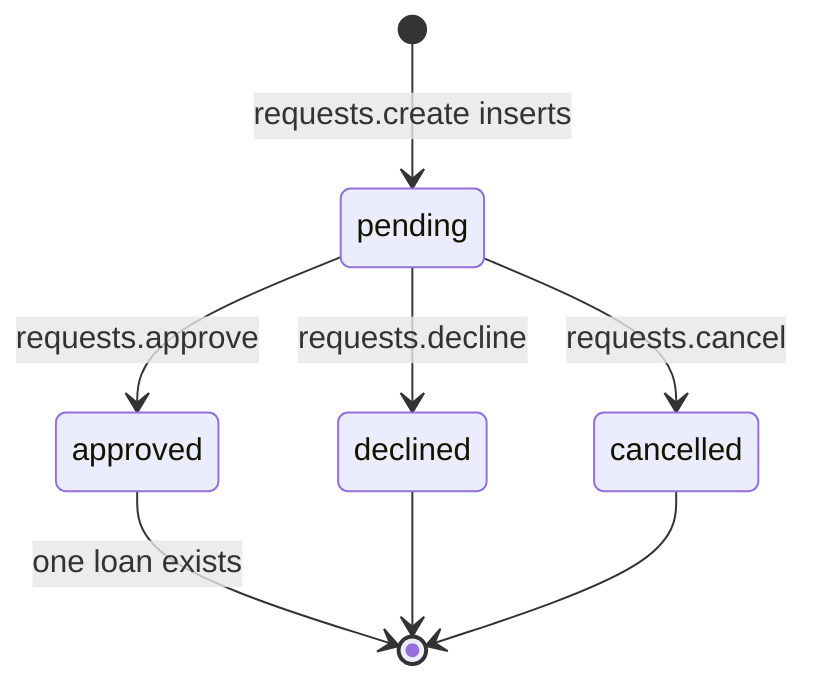

**Figure 5. Request state machine.** Reading: a request is decided once; approval is the only transition that creates a loan, and an approved request can never be cancelled.

Rules:

- Every decision requires `status === "pending"`, otherwise `ALREADY_DECIDED`.
- Approval and decline are limited to `request.ownerId` or an admin. Cancellation is limited to `request.requesterId` or an admin.
- `decidedAt` and `decidedBy` are written by all three decisions. For a cancellation, `decidedBy` is the canceller, not necessarily the owner.
- There is no reopen, no edit and no delete. A mistake is corrected by a new request.

### 9.2 Loan status

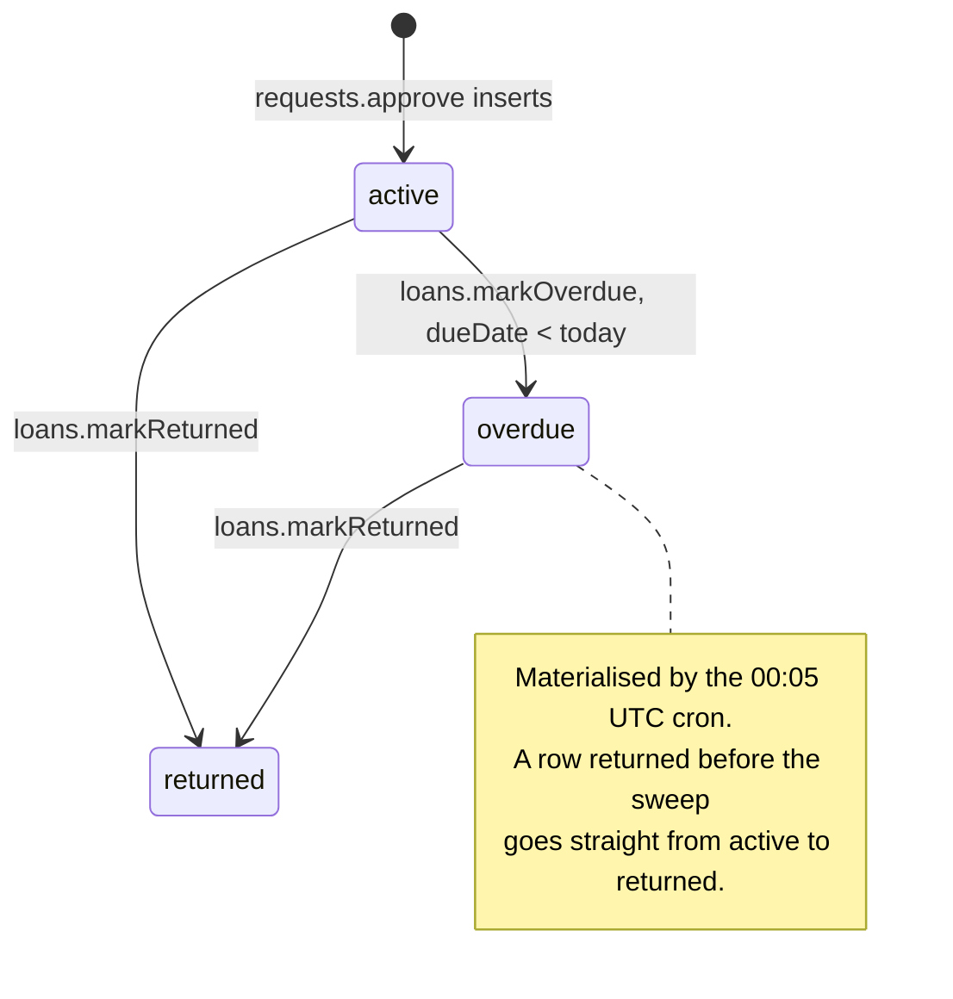

**Figure 6. Loan state machine.** Reading: a loan is created `active`, the daily sweep moves it to `overdue` once its due date has passed, and the lender closes it as `returned`.

Rules:

- `markReturned` is idempotent. A second call returns the id and keeps the first `returnedAt`.
- Only the lender (`loan.ownerId`) or an admin can close a loan. The borrower cannot.
- `loans.markOverdue` is the only writer of `overdue`. It only considers `active` rows, so a returned loan is never flipped, and a loan due today is not late (`dueDate < today`, not `<=`).
- A returned loan frees its dates in `findApprovedConflicts`, even if the original range has not ended.
- An unreturned `overdue` loan blocks every future date, because the item is still out; an `active` loan blocks only its approved range.
- The `overdue` boolean in the list reads is the stored status, not a comparison against the clock. The reminder feed computes from `dueDate` so it is correct before the sweep.

### 9.3 Reminder status

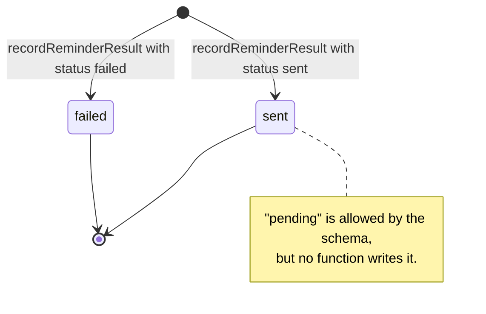

**Figure 7. Reminder row status.** Reading: the table records an outcome, not a queue item; there is no transition between `sent` and `failed`.

Rules:

- A row is only written through `recordReminderResult`, which is internal and called from the signed HTTP route.
- `sent` sets `sentAt` (from the payload or now) and patches the loan's `lastReminderAt`.
- `failed` stores a trimmed error capped at 500 characters and leaves `lastReminderAt` alone.
- `pending` is a valid schema value with no writer. It exists for a future queue that does not exist.

### 9.4 Automation event status

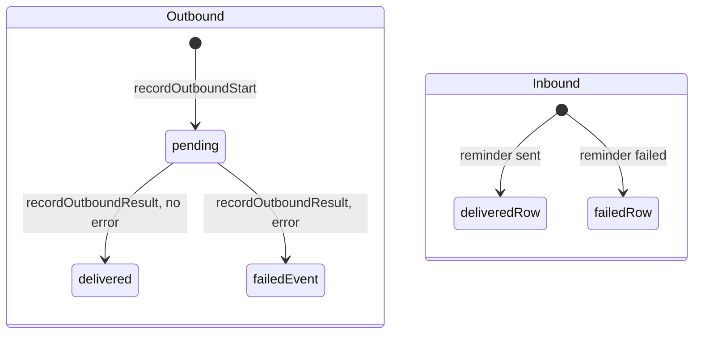

**Figure 8. Automation event status.** Reading: an outbound row starts pending and is closed by the action; an inbound row is inserted already resolved, because the outcome is what n8n reported.

Rules:

- Only `recordOutboundStart` writes `pending`.
- `recordOutboundResult` writes `delivered` when `lastError` is null and `failed` otherwise.
- Inbound rows are written by `recordReminderResult` with `delivered` for a sent reminder and `failed` for a failed one.
- `ignored` is a valid schema value with no writer.
- A pending row with no result is the signature of an action that died mid-flight. No sweeper closes it.

### 9.5 Permission matrix

The columns are a signed-in member with no relationship to the resource, the resource's owner (tool owner or lender), the requester or borrower, and an admin. "Own" means the caller sees only rows where they are the actor. "Empty" means the query succeeds and returns nothing.

| Capability | Visitor | Member | Owner | Borrower | Admin |
|---|---|---|---|---|---|
| `tools.listPublic` | Yes | Yes | Yes | Yes | Yes |
| `tools.listShelf` | No | Yes | Yes | Yes | Yes |
| `tools.listMine` | No | Own | Own | Own | Own |
| `tools.get` | No | No | Yes | No | Yes |
| `tools.availability` | No | Yes | Yes | Yes | Yes |
| `tools.create` | No | Yes | Yes | Yes | Yes |
| `tools.update` | No | No | Yes | No | Yes |
| `tools.remove` | No | No | Yes | No | Yes |
| `requests.create` | No | Yes, for another member's tool | Blocked on own tool | Yes | Yes |
| `requests.listMine` | No | Own | Own | Own | Own |
| `requests.listIncoming` | No | Empty | Rows for own tools | Empty | Rows for own tools |
| `requests.approve` | No | No | Yes | No | Yes |
| `requests.decline` | No | No | Yes | No | Yes |
| `requests.cancel` | No | No | No | Yes, while pending | Yes |
| `loans.listMine` | No | Own | Own | Own | Own |
| `loans.listIncoming` | No | Empty | Rows for own tools | Empty | Rows for own tools |
| `loans.markReturned` | No | No | Yes | No | Yes |
| `loans.overdue` | No | No | No | No | Yes |
| `admin.listUsers` | No | No | No | No | Yes |
| `admin.setTrustedLender` | No | No | No | No | Yes |
| `admin.listTools` | No | No | No | No | Yes |
| `admin.removeTool` | No | No | No | No | Yes |
| `admin.listLoans` | No | No | No | No | Yes |
| `automation.recentActivity` | No | No | No | No | Yes |
| `automation.loanActivity` | No | No | Yes | Yes | Yes |
| `users.store` | No | Yes | Yes | Yes | Yes |
| `users.current` | Null | Own | Own | Own | Own |
| `GET /n8n/overdue` | No token access | No | No | No | No, HMAC only |
| `POST /n8n/reminder-result` | No token access | No | No | No | No, HMAC only |

Two nuances matter in an interview. First, the list queries for a non-owner return an empty array rather than `FORBIDDEN`; they filter by the caller's id, so there is nothing to forbid. Second, an admin does not get every request through `requests.listIncoming`; that query is scoped to `ownerId`. The admin surface for requests is the per-tool view and the absence of a board-wide request table is a real gap if you need moderation.

### 9.6 Availability and overlap

The rule lives in one function, `findApprovedConflicts` in `convex/lib/availability.ts`:

1. Read the `approved` requests for the tool through `by_tool_status`, newest first and capped at 200 rows.
2. Skip the request being decided, when one is passed.
3. Load the loan for each through `by_request` and drop it when the loan is `returned`.
4. Compare the asked range with the booking's effective end: `9999-12-31` when the loan is `overdue`, otherwise the request's own `endDate`.
5. Everything that overlaps is a conflict, reported with the request's real dates.

A worked example, with dates as the code compares them:

| Existing approved range | Asked range | Result |
|---|---|---|
| 2026-03-10 to 2026-03-12 | 2026-03-12 to 2026-03-14 | Conflict, they share the 12th |
| 2026-03-10 to 2026-03-12 | 2026-03-13 to 2026-03-14 | Free, the next free start is the 13th |
| 2026-03-10 to 2026-03-12 | 2026-03-08 to 2026-03-10 | Conflict, they share the 10th |
| 2026-03-10 to 2026-03-12, loan returned | 2026-03-11 to 2026-03-12 | Free, the item is back |
| 2026-03-10 to 2026-03-12, loan still out (overdue) | Any future range | Conflict, reported as 2026-03-10 to 2026-03-12 |

Pending requests do not block, because the owner has not committed. Declined and cancelled requests never block. A rental that is returned early frees the remaining days. An unreturned overdue loan blocks every future date, because the app cannot know when the item will come back; the next booking has to wait for the return or for the owner to resolve it by hand.

Three different checks use this rule:

- `requests.create` refuses a conflicting new request with `TOOL_UNAVAILABLE`.
- `requests.approve` refuses to approve a request that now conflicts with an earlier approval, and the losing request stays pending.
- `tools.availability` reports the conflicts to the form, which still lets the member submit and lets the server decide.

A separate duplicate rule in `requests.create` covers the same borrower asking twice: same tool, overlapping range, status `pending` gives `ALREADY_REQUESTED`. An approved request is left to the availability rule above, so a returned loan frees the dates for the same borrower too.

### 9.7 The overdue sweep

There are two sweeps, and they do different jobs.

**Convex, daily at 00:05 UTC: materialise the status.** `internal.loans.markOverdue` reads `loans.by_status_due` for `active` rows with `dueDate < today`, patches each to `overdue`, and returns the count. The list views read that stored value, so they never compare a date with the clock; the shelf returns the unreturned bookings and the client labels a past end date as overdue. The job is bounded to 1000 rows per run; a larger backlog is caught up over the following days.

**n8n, daily at 09:00 (instance timezone): send the reminders.** This is still a pull, not a push from Convex:

1. n8n's `Every day at 09:00` schedule trigger starts `overdue-reminders`.
2. `Build overdue request` signs an empty body with the current millisecond timestamp.
3. n8n calls `GET /n8n/overdue` on the Convex site origin.
4. `convex/http.ts` verifies the signature, then calls `internal.loans.overdueForAutomation({ asOf: todayIso() })`.
5. `collectOverdue` reads open loans with `dueDate < asOf`, drops any with `returnedAt`, sorts by due date, and returns the borrower and owner details with `daysOverdue`. It reads both `active` and `overdue` so a loan is reported before the 00:05 sweep has flipped it.
6. n8n builds one reminder per loan whose key is not already in its static data. The key is `overdue-reminder:<loanId>:<dueDate>`.
7. n8n emails the borrower, then posts the outcome to `/n8n/reminder-result`.
8. Convex writes the reminder row, the inbound event and the ledger row, and patches `lastReminderAt`.

`asOf` is a required argument on both overdue functions. The admin query takes it from the caller; the HTTP route always passes today in UTC. Neither function reads the wall clock, which is why the tests can pin a day.

"One reminder per loan" is accurate only in the sense of one per due date. Because `dueDate` is part of the key, a loan whose due date were changed would get a second reminder. No function changes `dueDate`, so in practice it is one reminder per loan.

The sweep also runs on the `Manual run` trigger, which is how you test it without waiting a day. The n8n timezone comes from `GENERIC_TIMEZONE` (UTC in the compose default), and Convex computes `asOf` in UTC, so the two agree on what "today" means.

### 9.8 The public allowlist

`tools.listPublic` is the only function that returns data to an anonymous caller. `users.current` is also callable without a token, but it returns `null`. The `listPublic` handler reads active tools and maps each to `{ name, category }`. Its `returns` validator declares the same two fields. Both are needed: the validator is the contract, and the map is the implementation.

What is public: a tool's name and category, only while `status: "active"`.
What is not public: the owner's id, name, email, trust flag, the description, the dates, the status, and every timestamp.

The public page is a Server Component (`src/components/PublicToolList.tsx`), so the HTML arrives from the server with the list already rendered. The browser can still call `tools.listPublic` directly; the projection is what makes that safe, not the page. The signed-in shelf (`tools.listShelf`) adds the owner's display name, the trusted badge, `ownerIsMe` and the approved booking ranges (including a past booking whose loan is still out, which the client labels overdue), because a borrower has to know who they are asking and when the item is free. Email stays behind `requests.listIncoming` and `loans.listIncoming`, visible only to the owner or lender.

## 10. Frontend

The frontend is the Next.js App Router with two personalities. The public page is server-rendered and reads Convex once per request. The dashboard is a client-side application that subscribes to Convex and renders from live query results.

### 10.1 Routes

| Route | File | Rendering | Auth gate |
|---|---|---|---|
| `/` | `src/app/page.tsx` | Server page, request-rendered (`instant = false`), shelf streamed under `Suspense` | Public. A signed-in visitor stays on the page and sees "Open the app". |
| `/sign-in/[[...sign-in]]` | `src/app/sign-in/[[...sign-in]]/page.tsx` | Server wrapper around Clerk's `<SignIn>` | Public |
| `/sign-up/[[...sign-up]]` | `src/app/sign-up/[[...sign-up]]/page.tsx` | Server wrapper around Clerk's `<SignUp>` | Public |
| `/dashboard` | `src/app/dashboard/page.tsx` | Server shell, client screen | `src/proxy.ts` and `src/app/dashboard/layout.tsx` |
| `/dashboard/listings` | `src/app/dashboard/listings/page.tsx` | Server shell, client screen | Same two gates |
| `/dashboard/requests` | `src/app/dashboard/requests/page.tsx` | Server shell, client screen inside `Suspense` because it reads `?tool=` | Same two gates |
| `/dashboard/incoming` | `src/app/dashboard/incoming/page.tsx` | Server shell, client screen | Same two gates |
| `/dashboard/loans` | `src/app/dashboard/loans/page.tsx` | Server shell, client screen | Same two gates |
| `/dashboard/admin` | `src/app/dashboard/admin/page.tsx` | Server shell, client screen | Same two gates, plus a role branch in the screen |

The `dashboard` segment also supplies `loading.tsx` (segment skeleton) and `error.tsx` (segment error boundary). There is no route for a single tool, no settings page, no account page and no 404 page beyond Next's default.

### 10.2 Sign-in and user bootstrap

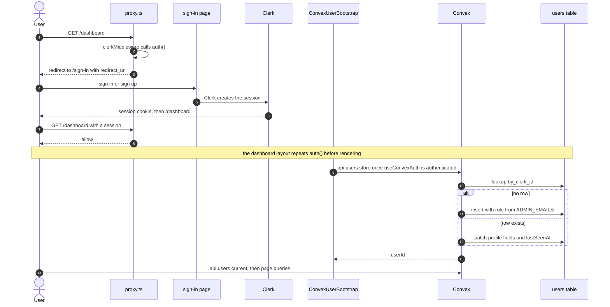

**Figure 9. Sign-in and bootstrap.** Reading: Clerk owns the credential, the proxy is the optimistic redirect, the layout is the authoritative server check, and the root bootstrap creates the Convex row.

The sign-in pages use Clerk's hosted component with `fallbackRedirectUrl="/dashboard"`. The public header reads `auth()` on the server and swaps its call to action between `/sign-up` ("Get started") and `/dashboard` ("Open the app"). `SignInCta` uses Clerk's modal with `forceRedirectUrl="/dashboard"` so a sign-in started from the landing page ends in the app.

The proxy has one rule: `/dashboard` and anything under it needs `userId`. It writes the redirect itself instead of calling `auth.protect()`, because `protect()` answers non-page requests with a not-found error, so the same URL returned 404 to `curl` and 307 to a browser. The explicit redirect also carries `redirect_url` so the visitor returns to the page they asked for. `requestBase` builds that redirect from `x-forwarded-host` and `x-forwarded-proto`, falling back to `Host`, because behind a tunnel `request.url` can be an internal address.

### 10.3 Provider nesting and component tree

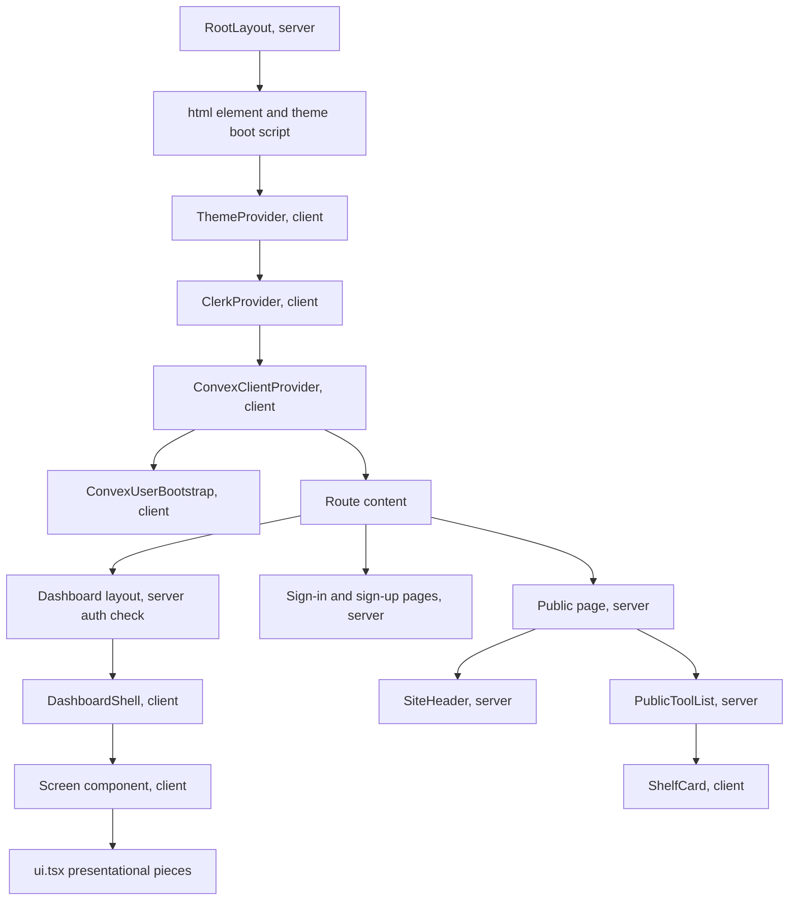

**Figure 10. Provider and component tree.** Reading: one root layout nests four providers; the public branch renders on the server, the dashboard branch hands off to a client shell and one screen per route.

Component tree per route:

| Route | Tree |
|---|---|
| `/` | `SiteHeader` (server) then `Hero`, `Suspense` around `PublicToolList` to `ShelfCard`, `HowItWorks`, `WhyBand`, `CallToAction`, `SiteFooter` |
| `/dashboard` | `DashboardShell` to `OverviewScreen` to `PageHeader`, `OverviewStats`, `ShelfBrowser` to `ShelfCard` |
| `/dashboard/listings` | `DashboardShell` to `ListingsScreen` with create form, edit form, confirm-remove |
| `/dashboard/requests` | `DashboardShell` to `Suspense` to `RequestsScreen` with request form, pending list, history |
| `/dashboard/incoming` | `DashboardShell` to `IncomingScreen` with pending list and decided list |
| `/dashboard/loans` | `DashboardShell` to `LoansScreen` with lent list and borrowed list |
| `/dashboard/admin` | `DashboardShell` to `AdminScreen` to role branch, then `AdminPanels` with listings, loans, accounts and `AutomationFeed` |

### 10.4 Server and client boundary

Server Components: `src/app/layout.tsx`, `src/app/page.tsx`, the landing sections (`SiteHeader`, `Hero`, `HowItWorks`, `WhyBand`, `CallToAction`, `SiteFooter`), `PublicToolList`, both Clerk pages, `src/app/dashboard/layout.tsx`, and the six dashboard page files.

Client Components: `ThemeProvider`, `ThemeSwitcher`, `ClerkProvider` and `ConvexClientProvider` (the providers are client by nature), `ConvexUserBootstrap`, `DashboardShell`, every dashboard screen, `ShelfCard`, `SignInCta`, and `dashboard/error.tsx`.

`src/components/ui.tsx` has no `"use client"` directive. It is pure presentational code with no hooks, so it can be imported by both sides and lands in whichever bundle needs it. Keep it that way: adding a hook to that file would turn every server import into an error.

The boundary that matters is the Convex client. `ConvexClientProvider` creates one `ConvexReactClient` at module scope, so React re-renders cannot open a second WebSocket. The provider throws at import time if `NEXT_PUBLIC_CONVEX_URL` is missing, which makes a misconfigured build fail loudly instead of rendering empty screens.

### 10.5 Actions, errors and states

Every dashboard mutation goes through `useAction` (`src/lib/use-action.ts`). It holds three pieces of state: `pendingKey`, `error`, `notice`. `run(key, action, success)` sets the key, clears the messages, awaits the mutation, sets the success line, and returns a boolean so a form can decide whether to reset. The key is a string like `approve:<requestId>` or `remove:<toolId>`, so only the clicked row shows a spinner while the rest of the list stays usable.

`errorMessage` (`src/lib/convex-error.ts`) turns the failure into one sentence:

- A `ConvexError` with a string payload is shown as is.
- A `ConvexError` whose payload is an object with `message` is shown by that message. Every backend rule uses this shape.
- Any other `Error` shows its first line, which strips a multi-line network stack.
- Anything else becomes "Something went wrong. Try again."

This is why the UI never duplicates a rule message. The server writes the sentence; the client prints it.

States, route by route:

- **Loading**: `dashboard/loading.tsx` shows `PageSkeleton`. Inside screens, `SkeletonList` covers lists, `ShelfSkeleton` covers the shelf, `PublicToolListSkeleton` covers the public list, and `DashboardShell` renders `ShellSkeleton` while `useConvexAuth` is loading or `users.current` is undefined.
- **Empty**: each section has a specific `EmptyState`: "The shelf is empty", "No pending requests", "No one is waiting on you", "Nothing of yours is out", "You have not listed anything yet", "No automation events yet".
- **Error**: `dashboard/error.tsx` catches a thrown query in the segment, prints `errorMessage(error)`, and offers `reset`. The text says nothing was changed and suggests checking the Convex deployment.
- **Session not ready**: `DashboardShell` has two explicit screens, "Connecting your session" when `useConvexAuth` is not authenticated and "Setting up your account" when the Convex row is still missing after a failed `store`.

### 10.6 The public list's server path

`src/app/page.tsx` wraps `<PublicToolList />` in `Suspense` with `PublicToolListSkeleton`. The component does three things:

1. `await connection()` opts the boundary out of prerendering, so the Convex client never runs during a static build.
2. `fetchQuery(api.tools.listPublic, {})` from Convex's Next.js helper package runs on the server and returns the two-field projection.
3. A thrown error is logged and turned into `null`, which renders "The shelf could not be loaded. Refresh the page to try again." instead of taking the landing page down.

The returned list is sorted by category then name and passed to `ShelfCard`, a client component that filters in memory by a search string and a category chip. The card links each row to `/sign-in`. It cannot show an owner, a date or a description, because the server never sent one.

### 10.7 Theme runtime and tokens

The theme has three choices: `system`, `light`, `dark`. The storage key is `lendloop-theme`. `src/lib/theme.ts` owns the rules:

- `parseStoredTheme` accepts only the three values and falls back to `system`.
- `resolveTheme` maps `system` to the OS preference and keeps an explicit choice.
- `applyThemeClass` toggles `.dark` on `<html>` and updates the `theme-color` meta.
- `themeBootScript` is an inline string that runs in `<head>` before first paint. It reads storage, falls back to `matchMedia`, and sets both the class and the chrome colour. Every step is wrapped so a throwing `localStorage` or a missing `matchMedia` still leaves a defined theme.

`ThemeProvider` reads the stored value in a lazy initializer (the same source the boot script used), applies the class in a layout effect, listens for OS changes, and listens for `storage` events so other tabs stay in step. `ThemeSwitcher` is the accessible menu: Enter, Space or ArrowDown opens, arrows and Home/End move, Escape and Tab close and return focus, and each item is a real button with `aria-checked`. The sun and moon icons are swapped by CSS (`dark:hidden` and `hidden dark:block`), so the icon follows the class before React hydrates and cannot flash.

The tokens live in `src/app/globals.css`. The `:root` block holds the light palette, `.dark` holds the dark one, and `@theme inline` maps every token to a Tailwind utility (`--color-background`, `--color-primary`, and so on). The file comments call these the 32 shadcn colour roles plus the product variants: positive, warn, danger, info, inverse, photo and the rule greys. `docs/design/design-tokens.css` is the design source; `docs/design/design-tokens.json` records the name mapping. The app copies the values into `globals.css` rather than importing the design file, so the two can drift. `tests/theme.test.ts` is the guard that keeps `THEME_COLORS` and the two `--background` values in sync.

### 10.8 Responsive behaviour

The layout container is `.ll-container`: full width, `max-width: 1440px`, 24 px gutters, 48 px at 768 and 96 px at 1280. Tailwind's default breakpoints are used: `sm` 640, `md` 768, `lg` 1024, `xl` 1280.

| Area | Small screens | Large screens |
|---|---|---|
| Public header | Brand, theme button, one CTA; nav links hidden | Three anchor links and the CTA on one 76 px row |
| Hero | Stacked copy, buttons full width, photo below | Two columns, copy on the left, framed photo on the right |
| Shelf card | Search and wrapped category chips above the rows | Left panel 452 px, scrollable rows on the right with a custom thumb |
| How it works | Three steps stacked with rules | Three columns with vertical rules |
| Why band | Photo above the copy | Photo left, copy right |
| CTA band | Panel inset, full-width button | Copy left, full-height photo right |
| Dashboard header | Horizontal scrolling nav, theme button, avatar | Same nav with the user name and admin badge |
| Dashboard grids | One column, two for stat cards | Two or three columns |

The shelf's category chips deliberately wrap at every width; the design spec describes a horizontal scroller, and the component comment explains that the scroller cut the fourth chip in half at 390 px. This is a case where the built code differs from `docs/design/redesign-spec.md`, and the code is the current truth.

## 11. Automation

Three n8n workflows do all the automation. The JSON is in `n8n/`, contains no credentials, and is imported by hand. A fresh import is inactive (`"active": false` in each file) and must be published.

| Workflow | File | Trigger | Nodes | Output |
|---|---|---|---|---|
| LendLoop · Request notification | `n8n/request-notification.json` | Webhook `POST /webhook/lendloop/request-created`, `rawBody` on, response mode `responseNode` | Request webhook, Verify signature, Signature valid?, Build notification, Send email, Respond 200, Respond 401 | Email to the tool owner through Resend, or a 401 |
| LendLoop · Overdue reminders | `n8n/overdue-reminders.json` | Schedule `0 9 * * *` and a Manual trigger | Build overdue request, Fetch overdue loans, Prepare reminders, Send reminder, Build write-back, Write back to Convex, Remember sent | One email per newly overdue loan, one signed write-back per email |
| LendLoop · Error handler | `n8n/error-handler.json` | Error Trigger | On workflow error, Format alert, Send alert | Alert email to `LENDLOOP_ALERT_EMAIL` |

### 11.1 Request notification

1. The webhook node stores the raw body and exposes the headers.
2. `Verify signature` resolves settings as `$env.NAME` first and `$vars.NAME` second, then:
   - requires `N8N_HMAC_SECRET`,
   - requires a 13-digit timestamp and a 64-hex signature,
   - rejects a timestamp more than five minutes from `Date.now()`,
   - rebuilds the HMAC over the raw body,
   - compares with `crypto.timingSafeEqual`,
   - parses the JSON and returns `{ verified, reason, payload }`.
3. `Signature valid?` is a boolean IF. True goes to `Build notification`, false goes to `Respond 401`.
4. `Build notification` reads `payload.tool`, `payload.borrower`, `payload.owner`, the dates and the message. It escapes HTML, writes a text and an HTML version, and sets the subject `LendLoop: <tool> requested by <borrower>`.
5. `Send email` posts to `https://api.resend.com/emails` with a header-auth credential named `Resend API key`.
6. `Respond 200` returns `{ ok: true, delivered: true, requestId }`. Convex treats any 2xx as delivered.

The workflow does not dedupe. A manual replay of a successful execution sends a second email. Convex sends the idempotency key in the body and in `x-lendloop-idempotency-key` so the execution log can be tied to one request, but n8n keeps no outbound ledger. That is a stated limit, not an oversight: the path that must not duplicate is the database write-back, and that one is enforced.

### 11.2 Overdue reminders

1. The schedule node fires at 09:00 in the instance timezone, or `Manual run` starts it.
2. `Build overdue request` signs the empty string with the current millisecond timestamp and builds `{ url, headers }` for `GET <site>/n8n/overdue`.
3. `Fetch overdue loans` sends the two headers and receives `{ asOf, count, loans }`.
4. `Prepare reminders` reads workflow static data, prunes keys older than 30 days, and for each loan builds the key `overdue-reminder:<loanId>:<dueDate>`. A key already in `store.sent` is skipped. The email uses `LENDLOOP_FROM_EMAIL`, the borrower address, the tool, the due date, the days overdue and the owner name. With no reminders, it returns an empty array, and the rest of the workflow is skipped while the execution still finishes green.
5. `Send reminder` posts to Resend, one item per reminder.
6. `Build write-back` pairs each Resend response with the prepared reminder and builds the JSON body `{ idempotencyKey, loanId, kind: "overdue", status: "sent", sentAt }`, signs it, and sets the two headers plus the body.
7. `Write back to Convex` posts to `<site>/n8n/reminder-result` with the raw body and the two headers.
8. `Remember sent` writes each accepted key into static data and returns `{ attempted, duplicates, remembered }`.

The static data is the first dedupe layer and the Convex ledger is the second. The static data stops the email being sent twice; the ledger stops the row being written twice. If the static data is lost, the ledger still protects the database, but the borrower may get a second email.

### 11.3 The HMAC contract

Both directions use the same contract, implemented in `convex/lib/signing.ts` and copied into every n8n Code node.

| Part | Value |
|---|---|
| Canonical string | `` `${timestamp}.${body}` `` |
| Timestamp | Unix epoch milliseconds as decimal text, 13 digits today |
| Body | The exact request body bytes as UTF-8 text; the empty string for a GET |
| Timestamp header | `x-lendloop-timestamp` |
| Signature header | `x-lendloop-signature` |
| Signature | Lowercase hex HMAC-SHA256 of the canonical string |
| Window | Reject when the timestamp is more than 300000 ms from the verifier's clock, in either direction |

The signature covers the timestamp as well as the body. Signing the body alone would leave a captured signature valid forever. Verification reads the raw body before parsing, so the bytes checked are the bytes sent.

Failure reasons, in the order the verifier checks them: `missing_timestamp`, `missing_signature`, `malformed_timestamp`, `timestamp_out_of_window`, `malformed_signature`, `signature_mismatch`. The n8n side adds `secret_not_configured` and `invalid_json`. A missing secret on Convex is a 500, never a bypass.

### 11.4 Inbound write-back with replay rejection

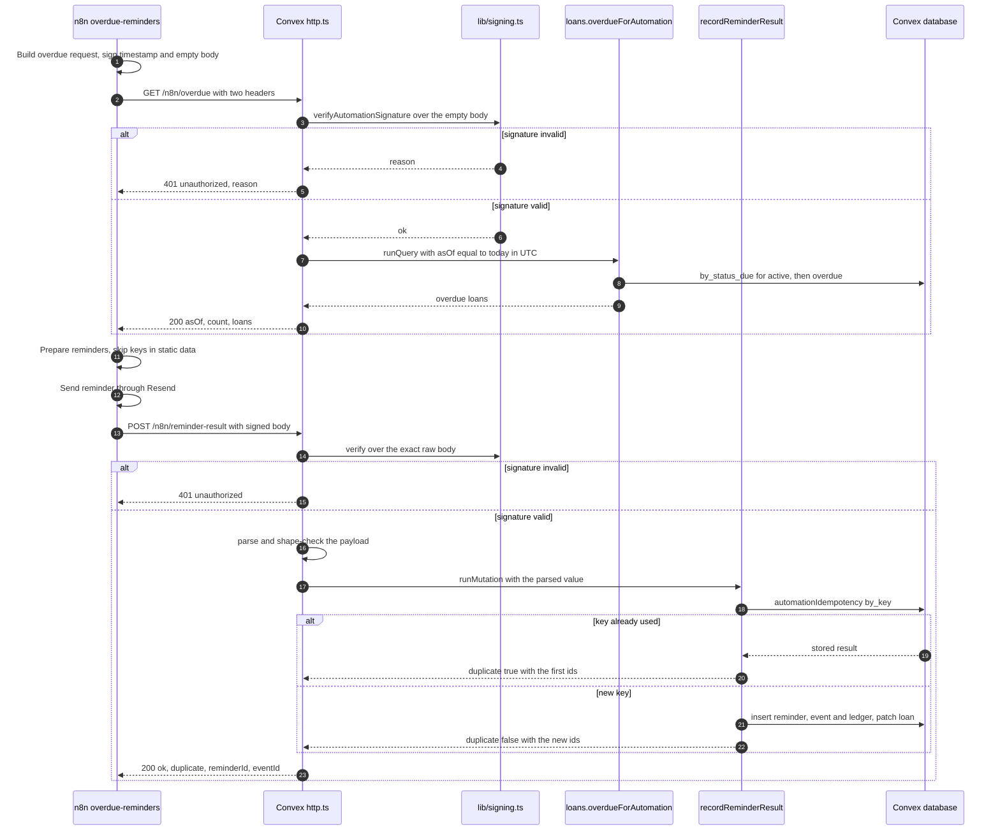

**Figure 11. Signed write-back and replay rejection.** Reading: the GET is safe to replay because it only reads; the POST is safe to replay because the ledger returns the first result and writes nothing.

Why the window alone is not enough: an attacker who captures a signed request can resend it within five minutes and the signature still verifies. Three layers handle that:

1. A replayed `GET /n8n/overdue` only reads.
2. A replayed `POST /n8n/reminder-result` hits `automationIdempotency.by_key` and returns `{ duplicate: true }`.
3. A row that predates the ledger is caught by `reminders.by_idempotency_key`.

The outbound direction has no dedupe ledger. It records every attempt in `automationEvents` and relies on the scheduler running once per request.

### 11.5 Error handling

- A non-2xx response, a network failure or a missing env var becomes `lastError` on the outbound event. The request is unaffected.
- The n8n workflows have no automatic retry. The error handler sends an alert with the workflow name, the failing node, the error message, the execution id and the execution URL, and says nothing was retried.
- Convex writes a `pending` outbound row before the call. If the action dies in between, the row stays `pending` with no error. Treat a growing set of pending rows as an operational signal.
- On the inbound side, a bad payload is a 400 with a message the workflow can branch on. An unknown loan is a 404. A replay is a 200 with `duplicate: true`, so n8n can treat it as success.

### 11.6 Running n8n locally with Docker

```bash
cp n8n/.env.example .env
# fill N8N_ENCRYPTION_KEY, N8N_HMAC_SECRET, LENDLOOP_CONVEX_SITE_URL
docker compose up -d
```

The compose file pins `n8nio/n8n:2.26.3`, exposes `${N8N_PORT:-5678}:5678`, sets `N8N_BLOCK_ENV_ACCESS_IN_NODE=false` so Code nodes can read `$env`, and sets `NODE_FUNCTION_ALLOW_BUILTIN=crypto` so HMAC signing works. It expects `N8N_ENCRYPTION_KEY`, `N8N_HMAC_SECRET` and `LENDLOOP_CONVEX_SITE_URL` and fails to start without them.

After the first start: import the three JSON files, create the `Resend API key` header-auth credential, select it on the three email nodes, set the error workflow on the two main workflows, and publish all three including the error handler. n8n 2.x refuses to run an inactive error workflow.

Then point Convex at the webhook:

```bash
npx convex env set N8N_REQUEST_WEBHOOK_URL "http://<host-reachable-from-convex>:5678/webhook/lendloop/request-created"
```

Convex runs in the cloud. `localhost` in that URL means the Convex machine, not your laptop. For a local run, expose port 5678 through a tunnel and use the public URL. If you only need to test the outbound contract, `node scripts/mock-n8n-receiver.mjs` listens on 8787 and verifies the signature without n8n.

## 12. Security

### 12.1 Trust boundaries

| Boundary | Who is trusted | How the trust is established |
|---|---|---|
| Browser to Next.js | The Clerk session cookie | Clerk SDK; the proxy and the dashboard layout read it |
| Browser to Convex | The signed JWT | `convex/auth.config.ts` pins the issuer and `aud: "convex"`; each function reads the subject |
| Convex to n8n | The shared secret | HMAC over `${timestamp}.${body}` with a five-minute window |
| n8n to Convex | The shared secret | The same contract, verified before any read or write |
| n8n to Resend | The Resend API key | An n8n header-auth credential, never in the JSON or the repo |
| Operator to deployments | The hosting account | Convex dashboard or CLI, n8n UI, Vercel and Clerk dashboards |

The important line is between identity and authorization. Clerk answers "who is calling". The `users` table answers "what may they do". Nothing in the request body can move either answer.

### 12.2 Threat table

| Threat | Control | Where it lives |
|---|---|---|
| A caller pretends to be another user | Identity comes only from `ctx.auth.getUserIdentity()`; the subject is the lookup key; no mutation accepts an acting user id. | `convex/lib/auth.ts`, `convex/lib/authz.ts`, `convex/lib/users.ts` |
| A caller reads or edits someone else's row (IDOR) | Every write calls `requireOwnerOrAdmin`; every list filters by the caller's id; admin functions call `requireAdmin` first. | `convex/lib/authz.ts` and each module |
| A caller promotes themselves to admin | `role` is read from the database; it is seeded from `ADMIN_EMAILS` only on insert and never refreshed from a token. | `convex/lib/roles.ts`, `convex/lib/users.ts` |
| A captured signed request is replayed | Five-minute window; idempotency ledger for writes; reminder key guard; static data in n8n. | `convex/lib/signing.ts`, `convex/automationStore.ts`, `n8n/overdue-reminders.json` |
| A body is altered in flight | HMAC over timestamp and raw body; constant-time compare; n8n verifies the same way. | `convex/lib/signing.ts`, `convex/http.ts`, `n8n/request-notification.json` |
| The shared secret leaks | It exists only in the Convex deployment env and the n8n env or variables; a missing secret fails closed with 500. | `convex/http.ts`, `convex/automation.ts`, `.gitignore` |
| Public data leaks through the anonymous endpoint | `tools.listPublic` maps and validates exactly `{ name, category }`. | `convex/tools.ts`, `src/components/PublicToolList.tsx` |
| A user injects HTML into an email | Both email builders escape every value interpolated into the HTML part and send a separate plain-text part. | `n8n/request-notification.json`, `n8n/overdue-reminders.json` |
| A forged `Host` header changes the sign-in redirect | The redirect origin comes from forwarded headers, with syntax validation but no allowlist; rely on a proxy that overwrites `Host` and on Clerk's allowed redirect origins. This is a residual risk, not a solved one. | `src/proxy.ts` |
| The public endpoint is scraped or hammered | No control. There is no rate limit on the Convex query. | Known gap, see 12.4 |
| PII accumulates in the audit trail | `automationEvents.payload` holds the outbound body, including both email addresses. The daily `maintenance.pruneAutomation` job deletes events older than 90 days and replay keys older than 7 days. | `convex/automationStore.ts`, `convex/maintenance.ts` |

### 12.3 Data minimisation

Each destination gets the fields it needs:

| Destination | Fields |
|---|---|
| Anonymous shelf | tool name, category |
| Signed-in shelf | tool name, category, description, owner display name, trusted flag, `ownerIsMe`, approved booking date pairs |
| Incoming request | requester name and email, tool name and category, dates, message, status |
| Incoming loan | borrower name and email, tool name, dates, due date, status |
| Admin views | every account's email, name, role and trust flag; every listing with owner email; every loan with both emails |
| Request webhook | event, request id, key, tool name and category, borrower and owner name and email, dates, message, created time |
| Overdue pull | per loan: id, tool, borrower and owner name and email, dates, due date, days overdue |
| Reminder write-back | key, loan id, kind, status, sent time, error |
| Loan activity feed | event kind, direction, workflow, status, error, created time |

The app never collects passwords, payment data, location, contacts, files or photos. Two caveats are worth repeating: descriptions and request messages are free text, so a user can type personal information into them, and the automation tables keep identifiers and payloads until the retention job removes them (7 days for replay keys, 90 days for events). The `reminders` table has no retention window yet.

### 12.4 Known gaps

| Area | Gap | Consequence |
|---|---|---|
| Abuse | No rate limit on `tools.listPublic` or on the signed endpoints | Scraping and request flooding are cheap |
| Privacy | No account deletion or data export | A user cannot remove their row, requests or loans |
| Retention | `reminders` rows are never pruned; replay keys go after 7 days and events after 90 | Reminder outcomes accumulate indefinitely |
| Scale | The lists are capped (200 member rows, 500 admin rows) but there is no pagination | A circle larger than the caps silently stops seeing older rows |
| Performance | The availability read is N+1 in the number of approved requests per tool, and capped at 200 approvals | Shelf reads grow with the booking history of each tool until the cap |
| Moderation | No board-wide request view for admins | An admin cannot review every request in one place |
| Testing | No browser or end-to-end tests | UI and integration regressions are found by hand |
| Supply chain | Caret ranges for Convex, Clerk, Vitest, TypeScript and ESLint | A fresh install can resolve different minor versions; the lockfile is the guard |

## 13. Configuration and environments

There are three separate environments. A value in one does not reach the others, and no value is committed. The templates are `.env.example` (app and CLI) and `n8n/.env.example` (n8n).

### 13.1 App environment

Read by Next.js and, for the `NEXT_PUBLIC_` names, embedded in the browser bundle.

| Variable | Required | Secret | Purpose | Where it is read |
|---|---|---|---|---|
| `NEXT_PUBLIC_CLERK_PUBLISHABLE_KEY` | Yes | No, public by design | Identifies the Clerk application | Clerk SDK |
| `CLERK_SECRET_KEY` | Yes | Yes | Server-side Clerk key | Clerk SDK |
| `NEXT_PUBLIC_CLERK_SIGN_IN_URL` | No | No | Path of the sign-in page, `/sign-in` | Clerk SDK |
| `NEXT_PUBLIC_CLERK_SIGN_UP_URL` | No | No | Path of the sign-up page, `/sign-up` | Clerk SDK |
| `NEXT_PUBLIC_CLERK_SIGN_IN_FALLBACK_REDIRECT_URL` | No | No | Where a signed-in user lands, `/dashboard` | Clerk SDK |
| `NEXT_PUBLIC_CLERK_SIGN_UP_FALLBACK_REDIRECT_URL` | No | No | Where a new sign-up lands, `/dashboard` | Clerk SDK |
| `CONVEX_DEPLOYMENT` | Yes for the CLI | No | Selects the deployment for `npx convex` | Convex CLI |
| `NEXT_PUBLIC_CONVEX_URL` | Yes | No | The deployment's HTTP API | `src/components/ConvexClientProvider.tsx` |
| `NEXT_PUBLIC_CONVEX_SITE_URL` | Written by the CLI | No | Origin of the HTTP actions; the app does not read it | Not read by the app; copy it to n8n as `LENDLOOP_CONVEX_SITE_URL` |
| `N8N_HMAC_SECRET` | No, local tooling only | Yes | Used by the mock receiver and copied to Convex and n8n | `scripts/mock-n8n-receiver.mjs` only |

A grep of `src/` finds exactly one direct `process.env` read, `NEXT_PUBLIC_CONVEX_URL` in `ConvexClientProvider`. Everything else in the table is consumed by the Clerk SDK, the Convex CLI or local tooling.

### 13.2 Convex deployment environment

These live on the deployment, not in a file. Set them with `npx convex env set NAME value` and read them back with `npx convex env list`.

| Variable | Required | Secret | Purpose | Where it is read |
|---|---|---|---|---|
| `CLERK_JWT_ISSUER_DOMAIN` | Yes | No | Clerk Frontend API origin, for example `https://<instance>.clerk.accounts.dev` | `convex/auth.config.ts` |
| `ADMIN_EMAILS` | No, but needed for admin | No, but sensitive | Comma-separated allowlist; a new row with a listed email gets `role: "admin"` | `convex/lib/roles.ts` |
| `N8N_HMAC_SECRET` | Yes for automation | Yes | Signs outbound calls and verifies inbound ones | `convex/automation.ts`, `convex/http.ts` |
| `N8N_REQUEST_WEBHOOK_URL` | No | No | Full URL of the request-notification webhook; empty means a recorded failure | `convex/automation.ts` |

A push fails until `CLERK_JWT_ISSUER_DOMAIN` is set, because `auth.config.ts` throws at module load. That failure is expected on the first `npx convex dev` of a new project.

### 13.3 n8n environment

Self-hosted n8n reads the environment. Cloud blocks `$env` inside nodes and falls back to Global Variables. That is why every Code node resolves `$env.NAME` first and `$vars.NAME` second.

| Variable | Required | Secret | Purpose |
|---|---|---|---|
| `N8N_ENCRYPTION_KEY` | Yes, self-hosted | Yes | Encrypts n8n's own credential store. Losing it means re-entering every credential. Cloud manages it. |
| `N8N_HMAC_SECRET` | Yes | Yes | Must equal the Convex deployment value |
| `LENDLOOP_CONVEX_SITE_URL` | Yes | No | Convex HTTP origin, used to build both endpoint URLs |
| `LENDLOOP_FROM_EMAIL` | Yes for email | No | Verified Resend sender |
| `LENDLOOP_ALERT_EMAIL` | Yes for alerts | No | Error workflow recipient |
| `N8N_HOST`, `N8N_PORT`, `N8N_PROTOCOL`, `N8N_WEBHOOK_URL`, `GENERIC_TIMEZONE` | Self-hosted | No | Public address and timezone; set the URL to the public https origin behind a tunnel |
| `NODE_FUNCTION_ALLOW_BUILTIN` | Fixed in compose | No | `crypto`, so Code nodes can HMAC sign |
| `N8N_BLOCK_ENV_ACCESS_IN_NODE` | Fixed in compose | No | `false`, so self-hosted nodes can read `$env`. n8n 2.x defaults it to true. |
| `N8N_SECURE_COOKIE`, `N8N_DIAGNOSTICS_ENABLED`, `N8N_PERSONALIZATION_ENABLED`, `N8N_HIRING_BANNER_ENABLED` | Fixed in compose | No | Local conveniences: http cookies, diagnostics off, banners off. Turn the cookie flag on behind TLS. |

The Resend API key is not an environment variable. It lives in n8n as the header-auth credential `Resend API key` with header `Authorization` and value `Bearer re_...`. It never appears in the workflow JSON or in this repository.

### 13.4 Environment separation

| Concern | Development | Production demo |
|---|---|---|
| Convex | A dev deployment created by `npx convex dev` | A production deployment pushed by `npx convex deploy` |
| Clerk | Keyless, then claimed; or your own development instance | Development instance (`pk_test_...`) for the demo, or a production instance on a domain you control |
| Next.js | `next dev` on port 3000 | Vercel with the detected Next.js preset |
| n8n | Docker on port 5678, or Cloud | n8n Cloud, published workflows |
| Secrets | `.env.local` and the dev deployment env | Vercel env, the production deployment env, n8n env or variables |

Three rules keep the tiers apart:

1. `N8N_HMAC_SECRET` never goes to Vercel. It lives on the Convex deployment and in n8n.
2. A Clerk production instance needs a domain you control, because its Frontend API is served on `clerk.<your-domain>`. A `*.vercel.app` host can only use a development instance.
3. Set `CLERK_JWT_ISSUER_DOMAIN`, `ADMIN_EMAILS`, `N8N_HMAC_SECRET` and `N8N_REQUEST_WEBHOOK_URL` on the production deployment before the first `npx convex deploy`, because the auth config is read at deploy time.

Rotation: rotating the HMAC secret requires updating Convex and n8n together. During the gap, one side rejects the other's signature. A key id in the header is the usual way to rotate without downtime; this code has no key id, so plan a short maintenance window. Rotating the Resend key is one credential edit in n8n. Rotating Clerk keys is a dashboard operation plus a Vercel env update.

The repo has no secret because `.gitignore` excludes `.env*`, `.clerk`, `.vercel` and `tsconfig.tsbuildinfo`, with explicit exceptions for the two `.env.example` files. If you find a credential in a tracked file, treat it as leaked, rotate it, and remove it from history rather than only deleting the line.

## 14. Running it

### 14.1 Prerequisites

- Node.js 20.9 or newer. The README says tested on Node 22.
- npm.
- A free Convex account. `npx convex dev` opens a browser to sign in.
- A Clerk account, or nothing for keyless local development.
- Docker only if you want self-hosted n8n.
- A Resend account and a verified sender only if you want real email. The signed integration can be tested without it.

### 14.2 First run

```bash
npm install
npx convex dev
```

The first `npx convex dev` creates a development deployment, writes `CONVEX_DEPLOYMENT`, `NEXT_PUBLIC_CONVEX_URL` and `NEXT_PUBLIC_CONVEX_SITE_URL` to `.env.local`, then tries to push. The push stops with:

```text
Environment variable CLERK_JWT_ISSUER_DOMAIN is used in auth config file but its value was not set.
```

That is expected. The deployment and the `.env.local` values already exist. Continue:

```bash
# terminal 2
npm run dev
```

Open <http://localhost:3000>. With no Clerk keys, `@clerk/nextjs` starts in keyless mode, provisions a development application, writes the publishable and secret keys to `.env.local`, and prints a claim URL. Open it and claim the application. If the app started before the keys were written, stop it and run `npm run dev` again.

Then connect Clerk to Convex:

1. In the Clerk dashboard, open Configure then Convex (older dashboards call it JWT Templates) and activate the integration. It sets `aud: "convex"`, which `convex/auth.config.ts` requires.
2. Confirm the token includes an `email` claim. If not, add `{ "email": "{{user.primary_email_address}}" }` to the template.
3. Set the issuer and an admin on the deployment:

```bash
npx convex env set CLERK_JWT_ISSUER_DOMAIN https://<instance>.clerk.accounts.dev
npx convex env set ADMIN_EMAILS "you@example.com"
```

4. Run `npx convex dev` again so the auth config reaches the deployment.
5. Sign in once at <http://localhost:3000/sign-in>. `ConvexUserBootstrap` creates the row.

If you only need one push and no watcher, use `npx convex dev --once`. If the app is running, stop it before `npm run build`: both write to `.next`.

### 14.3 Seed

```bash
npx convex run seed:dev '{"confirm":"seed-demo-data"}'
```

The `confirm` argument is required: without it the mutation throws `SEED_NOT_CONFIRMED`, so the command is safe to keep in a script that points at the wrong deployment.

Run it once for the base shelf. Run it again after your admin has signed in to get the admin-owned tools, requests and loans. Expected first result on an empty deployment: `seeded: true`, `tools: 7`, `demo: false`, `demoLoans: 0`. Expected after the admin phase: `seeded: false`, `tools: 11`, `demo: true`, `demoLoans: 5`.

### 14.4 Connect n8n

Use one option.

**Cloud**

1. Create an instance. The free Pro trial includes Global Variables.
2. Add `N8N_HMAC_SECRET`, `LENDLOOP_CONVEX_SITE_URL`, `LENDLOOP_FROM_EMAIL` and `LENDLOOP_ALERT_EMAIL` as variables.
3. Create the `Resend API key` header-auth credential.
4. Import the three JSON files.
5. Select the credential on each email node.
6. Set the error workflow on Request notification and Overdue reminders.
7. Publish all three, including the error handler.
8. Copy the production webhook URL for Request notification and set it on Convex:

```bash
npx convex env set N8N_REQUEST_WEBHOOK_URL "https://<instance>.app.n8n.cloud/webhook/lendloop/request-created"
```

**Docker**

```bash
cp n8n/.env.example .env
# fill the required values in .env
docker compose up -d
```

The container serves <http://localhost:5678>. Do the same import and credential steps, publish all three, then set `N8N_REQUEST_WEBHOOK_URL` to a URL Convex can reach. As above, `localhost` means the Convex machine, so use a tunnel for a local run.

### 14.5 Verify

```bash
npm run build
npm run typecheck
npm run lint
npm test
node scripts/mock-n8n-receiver.mjs --self-test
```

What success looks like at each step:

| Step | Success |
|---|---|
| `npx convex dev` after the issuer is set | Functions push, `_generated` updates, no auth config error |
| `npm run dev` and open `/` | The shelf renders with the seeded tools while signed out |
| Open `/dashboard` while signed out | Redirect to `/sign-in?redirect_url=...` |
| Sign in | Dashboard renders, header shows your name, the row exists in `users` |
| Open `/dashboard/admin` as the admin | Listings, loans, accounts and the automation feed |
| Create a request from a second account | The owner's Incoming shows it; `automationEvents` has a row |
| Run the n8n workflow manually | An overdue email, then an inbound `reminder.sent` event |
| `npm test` | 7 files, 107 tests, all passing |
| `node scripts/mock-n8n-receiver.mjs --self-test` | 5 of 5 checks passed |

To check the live signed endpoints:

```bash
N8N_HMAC_SECRET="<the deployment secret>" \
  node scripts/mock-n8n-receiver.mjs --convex-site https://<deployment>.convex.site
```

It checks that an unsigned `/n8n/overdue` gets 401, that a signed call gets 200, and, when there is at least one overdue loan, that a replayed reminder key returns `duplicate: true` without a second write.

### 14.6 Deploy

```bash
npx convex deploy
npx convex run --prod seed:dev '{"confirm":"seed-demo-data"}'
```

The first command pushes `convex/` to the production deployment, including the two daily cron registrations. The second is optional and only for a fresh demo; it needs the confirmation argument for the same reason as the local seed. Then import the repo into Vercel, keep the detected Next.js preset, and set the six app variables for Production, Preview and Development. `N8N_HMAC_SECRET` is not one of them.

## 15. Testing

```bash
npm test
```

At the revision 2 working tree that is 7 test files and 107 tests, all passing. Vitest runs in the `node` environment and includes `convex/**/*.test.ts` and `tests/**/*.test.ts`, as configured in `vitest.config.mts`.

Why `node` and not an edge-like environment: the Convex suite needs `process.env` (`ADMIN_EMAILS`, `N8N_HMAC_SECRET`, `N8N_REQUEST_WEBHOOK_URL`) and the real `fetch` for the outbound tests. The Convex runtime APIs the code actually uses — `process.env` and `crypto.subtle` — are available in the Node environment too, so the harness choice does not weaken the tests. This is an accepted deviation, recorded in section 20.4.

### 15.1 What the suite proves

| File | Tests | Behaviour it proves |
|---|---|---|
| `convex/users.test.ts` | 10 | First sign-in creates a `user` row; the first and later `ADMIN_EMAILS` entries seed admin; matching ignores case and spaces; a stored role survives a changed allowlist; no token is rejected; a token without email gets `EMAIL_MISSING`; `users.current` returns its eight-field projection with no `clerkId`; the seed refuses to run without `confirm: "seed-demo-data"` and writes nothing; the allowlist parser trims, de-duplicates, preserves order and rejects junk. |
| `convex/tools.test.ts` | 19 | Create trims and bounds, refuses blank and over-long input, refuses signed-out; `listPublic` returns exactly two fields and drops removed tools; `listMine` is scoped; update and remove allow owner and admin, refuse a stranger and a removed tool; `get` is owner or admin; availability handles empty, overlapping and adjacent ranges, ignores pending and declined, frees a returned loan, blocks every future range on an overdue loan, rejects bad ranges and removed tools; `listShelf` returns a past booking while the loan is out and omits a returned one. |
| `convex/requests.test.ts` | 18 | Create stores the denormalised owner and a trimmed message, refuses your own tool, a removed tool, a bad range, a start in the past, a range over 90 days, an approved overlap, a pending duplicate, a signed-out caller, and lets a returned loan free the same borrower's dates; approve creates a loan with `dueDate = endDate`; decline creates none; a stranger is refused; an admin can decide; a decided request cannot be decided again; approval re-checks overlap and the first approval wins; cancel is requester-only; list visibility is scoped. |
| `convex/loans.test.ts` | 9 | The lender confirms a return and a repeat call keeps the first timestamp; borrower and stranger cannot; an admin can; `markOverdue` flips past-due active rows, leaves future and returned rows alone; overdue returns only past-due unreturned rows with the right day counts; it is admin-only and validates `asOf`; `listMine` reports the stored `overdue` flag; `listIncoming` names the borrower and is scoped. |
| `convex/admin.test.ts` | 8 | `listUsers` returns the exact six fields and no `clerkId`; a non-admin is refused; trust can be set and cleared; a missing user is not found; `removeTool` soft-deletes and a non-admin is refused; `listLoans` returns all or one status and reports the stored overdue flag, and is admin-only. |
| `convex/automation.test.ts` | 31 | The signing helper accepts a genuine signature and rejects a tampered body, a wrong secret, a stale timestamp, a future timestamp, missing and malformed headers; constant-time compare behaves; the HTTP routes return 401 unsigned, 401 stale, 200 signed, 401 tampered, 400 malformed, 404 unknown loan; one key writes one reminder, one event and one ledger row, a replay writes nothing, a new key increments attempts, a failed reminder stores its error, a future `sentAt` is clamped; both activity feeds enforce their audience and order; `pruneAutomation` prunes old keys and events and closes stale pending rows; the outbound action signs and delivers, records a 503, records a missing URL, and is scheduled by `requests.create`. |
| `tests/theme.test.ts` | 12 | The storage key, the three accepted values, the default, the resolution rules, the chrome colours matching `globals.css`; the boot script applies a stored choice over the OS, follows the OS for `system`, treats junk as system, survives throwing storage and missing `matchMedia`, and sets the meta colour. |

### 15.2 How the harness works

`convex-test` runs the real functions in the Vitest process against an in-memory database. Every Convex suite starts with:

```ts
const modules = import.meta.glob("./**/*.ts");
const t = convexTest(schema, modules);
```

`t.withIdentity({ subject, issuer, email, emailVerified, name })` sets the caller for subsequent `t.query`, `t.mutation` and `t.action` calls. `t.run(async (ctx) => ...)` reaches the database directly for seeding and assertions. `t.fetch(path, init)` calls the HTTP router. `t.finishAllScheduledFunctions(() => {})` drains the scheduler, which is how the outbound test proves that `requests.create` actually triggered the action.

The outbound tests start a real `node:http` server on an ephemeral port, point `N8N_REQUEST_WEBHOOK_URL` at it, capture the request and verify the signature with the production helper. The theme test runs the real boot-script string in `node:vm` against a stub document, so a change to the string is exercised rather than only observed in a browser.

### 15.3 Adding a test for a new rule

Say you add a rule that a tool cannot be removed while it has an active loan. Put the rule in `tools.remove`, add a `TOOL_HAS_OPEN_LOAN` code to `convex/tools.ts` (it does not exist today), then add this test to `convex/tools.test.ts`. The snippet assumes `seedLoan` is added to the existing import from `convex/lib/fixtures.ts`.

```ts
test("a tool with an open loan cannot be removed", async () => {
  const t = setup();
  const { tool, owner, borrower } = await seedBase(t);
  await t.run(async (ctx) => {
    const requestId = await seedRequest(ctx, {
      toolId: tool,
      ownerId: owner,
      requesterId: borrower,
      startDate: isoDay(1),
      endDate: isoDay(2),
      status: "approved",
    });
    await seedLoan(ctx, {
      toolId: tool,
      requestId,
      ownerId: owner,
      borrowerId: borrower,
      startDate: isoDay(1),
      endDate: isoDay(2),
    });
  });

  await expect(
    t.withIdentity(signIn(OWNER_EMAIL)).mutation(api.tools.remove, { toolId: tool }),
  ).rejects.toMatchObject({ data: { code: "TOOL_HAS_OPEN_LOAN" } });
});
```

The shape to copy: seed through `convex/lib/fixtures.ts`, act as the relevant identity, assert the exact error code, then assert the row did not change. Add a passing case for the owner or admin path if the rule has an exception. Run `npm test`. If the new rule adds an index, also assert the query path that uses it, because without one the query falls back to a scan and can hit the function's read limits.

What the suite does not cover: React rendering, Clerk, the real n8n instance, Resend delivery, Vercel, and load. Those are checked by hand with the steps in 14.5.

## 16. Operations and troubleshooting

Start with the layer that fails. The signed endpoints and the Convex functions write their own errors to `automationEvents`; the n8n execution log names the failing node; the Convex dashboard shows function logs, scheduled jobs and table rows; the browser console shows client failures.

| Symptom | Likely cause | Fix | Where to look |
|---|---|---|---|
| `/dashboard` returns 404 or redirects in a loop | Clerk keys are missing, belong to different instances, or the sign-in URL is wrong; or a proxy rewrites `Host` and the redirect origin is wrong | Align `NEXT_PUBLIC_CLERK_PUBLISHABLE_KEY`, `CLERK_SECRET_KEY` and the Clerk instance; confirm `NEXT_PUBLIC_CLERK_SIGN_IN_URL=/sign-in`; restart the dev server; check the redirect origin built by `requestBase` | `src/proxy.ts`, `.env.local`, Clerk dashboard, browser network tab |
| The admin page body is blank | `users.current` is still `undefined` (Convex unreachable), or the segment threw, or the row is not an admin | Check the browser console and the Convex logs; confirm `NEXT_PUBLIC_CONVEX_URL`; sign out and in so `users.store` runs; confirm the row's `role` | `src/components/dashboard/DashboardShell.tsx`, `src/components/dashboard/AdminScreen.tsx`, `src/app/dashboard/error.tsx` |
| "Could not find public function" or "not found" on a new function | The function exists locally but was not pushed, or `_generated` is stale | Run `npx convex dev --once`; confirm the export name and file; do not edit `convex/_generated` | `convex/_generated/api.d.ts`, Convex dashboard |
| Clerk rejects a valid session, or Convex says no auth provider | The token issuer does not match `CLERK_JWT_ISSUER_DOMAIN`, or the JWT lacks `aud: "convex"` | Set the issuer to the same instance's Frontend API URL; activate the Convex integration in Clerk; re-push | `convex/auth.config.ts`, Convex env, Clerk JWT template |
| 401 from `/n8n/overdue` or `/n8n/reminder-result` | Missing or malformed headers, stale or future timestamp, wrong secret, clock drift, or a re-serialized body | Read the `reason` in the response; compare `N8N_HMAC_SECRET` on both sides; fix NTP; sign the exact raw body | `convex/lib/signing.ts`, `convex/http.ts`, n8n `Verify signature` |
| Duplicate reminder emails or duplicate reminder rows | n8n static data was lost, or `dueDate` changed, so a new key was generated; or the same key was sent with a different body | Inspect `automationIdempotency` by key and `reminders` by loan; keep `dueDate` stable; do not clear static data mid-run | `convex/automationStore.ts`, n8n workflow static data |
| The UI shows old code after a change | A dev server is running during the build, or Vercel is serving a cached deployment, or `.next` is stale | Stop `next dev`, run `npm run build` again, redeploy; delete `.next` only if the build itself is corrupt | `.next`, Vercel deployments |
| Port 3000 or 5678 is already in use | Another dev server or container is bound | `ss -ltnp` and look for port 3000 or 5678, stop the other process, or run `next dev -p 3001` | shell |
| Build or render fails and `/data` is full | Disk exhaustion stops writes mid-build | `df -h /data`; remove old build output or unused screenshots; retry | shell, `docs/screenshots` |
| Convex push fails with "CLERK_JWT_ISSUER_DOMAIN ... not set" | Expected before Clerk is configured | Set the env var, then push again | `convex/auth.config.ts`, Convex env |
| A new sign-in fails with `EMAIL_MISSING` | The Clerk JWT template has no `email` claim | Add `{ "email": "{{user.primary_email_address}}" }` to the Convex template | `convex/lib/users.ts` message, Clerk dashboard |
| Every dashboard query fails with `USER_NOT_SYNCED` | The bootstrap never succeeded, so no `users` row exists | Check the console for the bootstrap error; confirm the Convex deployment; reload so `users.store` retries | `src/components/ConvexUserBootstrap.tsx`, `convex/lib/authz.ts` |
| The public shelf is empty while tools exist | Every tool is `removed`, or the app points at a different deployment | Check `tools.status`; confirm `NEXT_PUBLIC_CONVEX_URL`; seed the deployment | `convex/tools.ts`, Convex data |
| An outbound event is `failed` | `N8N_REQUEST_WEBHOOK_URL` is empty, the path is wrong, the workflow is inactive, or the secret differs | Read `lastError`; open the n8n execution; fix the URL or secret; replay the request | `convex/automation.ts`, Convex `automationEvents`, n8n executions |
| n8n says "Workflow ... is not active and cannot be executed" | The error workflow is not published | Publish all three workflows, including LendLoop · Error handler | n8n workflow list |
| Resend rejects a recipient | `example.com` addresses are not deliverable, or the sender is not verified | Use real addresses and a verified sender | n8n execution, Resend dashboard |
| The build fails with "NEXT_PUBLIC_CONVEX_URL is missing" | The environment variable is absent in CI or Vercel | Set it in the build environment, then rebuild | `src/components/ConvexClientProvider.tsx`, Vercel env |
| The real admin sees "Admins only" | The row was created before `ADMIN_EMAILS` was set, or the email differs | Check `users.role`; the app has no promotion UI, so set the row by a one-off internal mutation or the Convex dashboard | `convex/lib/roles.ts`, `users` table |

Operational checks worth running after any deploy:

```bash
df -h /data
node scripts/mock-n8n-receiver.mjs --self-test
N8N_HMAC_SECRET="<secret>" node scripts/mock-n8n-receiver.mjs --convex-site https://<deployment>.convex.site
```

There is no metrics endpoint and no dashboard. The closest thing to monitoring is the admin Automation feed and the Convex dashboard's function logs and scheduled job history. If you need real alerting, put an alarm on failed `automationEvents` and on signed-endpoint 401s. That does not exist today.

## 17. How to change it

Each recipe names every file to touch and the check to run. The project has no code generator for application code, so the generated files are only `convex/_generated` and the Next build output.

### 17.1 Add a table field

Example: give a tool an optional `condition` string.

1. `convex/schema.ts`: add `condition: v.optional(v.string())` to the `tools` table. If a query will filter on it, add an index in the same block.
2. `convex/lib/validation.ts`: add a max length and a `requireText` or `optionalText` call if the field is user-supplied.
3. `convex/tools.ts`: accept the field in `create` and `update`, validate it, and add it to `toolView` if the manage screen needs it.
4. `convex/lib/fixtures.ts`: add the field to `seedTool` so tests can set it.
5. `src/components/dashboard/ListingsScreen.tsx`: add the input to the create and edit forms.
6. `src/components/dashboard/ShelfBrowser.tsx` or `src/components/landing/ShelfCard.tsx`: render it if borrowers should see it. Remember `tools.listShelf` must select it first.
7. `convex/tools.test.ts`: assert the new field trims, validates, and survives a read.

Run `npx convex dev --once` to push and regenerate types, then `npm test`, `npm run typecheck` and `npm run build`. Because the field is optional, existing rows need no migration. If it must be required, add it as optional, backfill with an internal mutation, then tighten the validator in a later deploy.

### 17.2 Add a query or mutation with auth

Example: `tools.countMine`.

1. `convex/tools.ts`: import `query` or `mutation` from `./_generated/server`, `v` from the Convex values package, and the auth helper you need from `./lib/authz`. Declare `args` and a `returns` validator. Call `requireUser` first. Read through an index, not a full scan, and never accept a user id argument.
2. If the function writes, throw `ConvexError({ code, message })` for every rule. Use an existing code where one fits; add a new code only for a new condition.
3. `src/components/dashboard/<Screen>.tsx`: call `useQuery(api.tools.countMine)` or the mutation through `useAction`. Do not disable a control to "enforce" a rule; show the server's sentence.
4. `convex/tools.test.ts`: add a test for the happy path, one for the forbidden path and one for the signed-out path.
5. Run `npx convex dev --once` so `api.d.ts` includes the function, then `npm test` and `npm run typecheck`.

Do not put business logic in a new HTTP route unless an external system needs it. The browser talks to Convex functions directly.

### 17.3 Add a dashboard route

Example: a read-only "Activity" page for members.

1. `src/app/dashboard/<name>/page.tsx`: create the file, import the screen, and add `export const instant = false;`. The dashboard layout already enforces the session.
2. `src/components/dashboard/<Name>Screen.tsx`: add `"use client"`, the `useQuery` calls, `PageHeader`, `Section`, `SkeletonList` and `EmptyState`. Reuse `src/components/ui.tsx` rather than new primitives.
3. `src/components/dashboard/DashboardShell.tsx`: add the route to the `navigation` array if it should appear in the header.
4. If the route reads search params, wrap the screen in `Suspense` in the page, as `src/app/dashboard/requests/page.tsx` does.
5. Add an error path: the segment boundary at `src/app/dashboard/error.tsx` covers thrown queries, but an empty result needs its own `EmptyState`.

Check: `npm run build`, `npm run typecheck`, then open the route signed out (redirect) and signed in (renders). The proxy matcher already covers every path under `/dashboard`.

### 17.4 Add an admin-only action

Example: an admin "restore listing" that sets a removed tool back to active.

1. `convex/admin.ts`: add a `mutation` with `args`, `returns`, and `await requireAdmin(ctx)` as the first statement. Throw `ConvexError` with a code for a missing tool.
2. Do not reuse a member mutation and branch on the role. Each admin entry point is separate so the rule cannot be reached by widening a normal call.
3. `src/components/dashboard/AdminScreen.tsx`: render the control inside `AdminPanels`, which only mounts for an admin. Treat that as presentation; the server check is the enforcement.
4. `convex/admin.test.ts`: assert an admin succeeds, a member gets `FORBIDDEN`, and a signed-out caller gets `UNAUTHENTICATED`.
5. If the action changes an invariant (for example, restoring a tool that has an open loan), add the check to the mutation, not to the UI.

Check: `npx convex dev --once`, `npm test`, `npm run typecheck`, and a manual pass as both roles.

### 17.5 Change a theme token

1. `src/app/globals.css`: change the value in `:root` for light and in `.dark` for dark. If you add a new token, map it in `@theme inline` so a Tailwind utility exists.
2. `src/lib/theme.ts`: if you changed `--background`, update `THEME_COLORS`. The boot script and the meta tag use those values before CSS loads.
3. `tests/theme.test.ts`: the test asserts the two background values and that they match `globals.css`. Update it only when the design change is intentional.
4. `docs/design/design-tokens.css` and `docs/design/design-tokens.json`: keep the design source in step, or record the divergence in a comment. The app does not import these files.

Check: `npm test`, then load `/` and `/dashboard` in both themes. Watch for a flash: the boot script must still set the class before paint, and the `theme-color` meta must match the resolved ground.

### 17.6 Add an n8n workflow

1. `n8n/<name>.json`: export the workflow from n8n with no credentials inside. Include a Code node that verifies the same canonical string and window if the workflow receives a Convex call.
2. If the workflow writes back, add the route to `convex/http.ts`, put the database work in an internal function in `convex/automationStore.ts`, and use an idempotency key. The route must verify the signature before parsing or writing.
3. Add any new setting to `n8n/.env.example` and, if the app or Convex needs it, to `.env.example` and the Convex env table in section 13.
4. Set the error workflow on the new workflow, publish it, and add it to the import steps in section 14.4.
5. Test with `node scripts/mock-n8n-receiver.mjs --self-test` for the contract and with a manual execution for the workflow. If the workflow calls Convex, check `automationEvents` for the inbound row.

Check: the signature rejection path (tamper the body), the success path, and a replay of the write-back.

## 18. Interview walkthrough

Short answers, each tied to a file. Use them as prompts, not scripts.

**1. What is LendLoop, in one minute?**
A shared tool shelf for a small trusted circle. A member lists a tool, another asks for a date range, the owner approves or declines, approval creates a loan, and the owner marks it returned. Identity comes from Clerk, data and rules live in Convex, and three n8n workflows send the request email, the overdue reminder and failure alerts. The interesting parts are the authorization inside each Convex function, the two-field public projection and the signed, idempotent automation boundary.

**2. Why Convex instead of a REST API and Postgres?**
Convex gives transactional functions, realtime subscriptions, a scheduler and HTTP actions in one service, so there is no API layer to write and the dashboard updates from the committed write. For a small app that removes a lot of code. The trade-off is vendor lock-in: schema, queries, indexes and auth integration are Convex-specific. The rules are deliberately kept in plain TypeScript helpers (`convex/lib/authz.ts`, `convex/lib/availability.ts`) so a move to SQL would port the logic, not rewrite it from scratch. The README's production table describes that migration.

**3. How does authentication work?**
Clerk holds the session. Its `convex` JWT template signs a token with `aud: "convex"` and an `email` claim. `convex/auth.config.ts` pins the issuer from `CLERK_JWT_ISSUER_DOMAIN`, so a token from another Clerk application never reaches a function. Inside a function, `requireIdentity` calls `ctx.auth.getUserIdentity()` and `requireUser` looks up the `users` row by `identity.subject`. No argument carries identity.

**4. Where does authorization live, and why not in middleware?**
Inside the function that performs the write. `requireUser`, `requireAdmin` and `requireOwnerOrAdmin` are called at the top of each handler in `convex/lib/authz.ts`, and each module uses them. Middleware and the proxy can only redirect before rendering; they cannot protect a mutation that a crafted client calls directly. The dashboard layout repeats `auth()` next to the data for the same reason: the check closest to the data is the one that must not be skipped.

**5. How do you stop one member editing another member's listing?**
`tools.update` and `tools.remove` load the row, then call `requireOwnerOrAdmin(ctx, tool.ownerId)`. The owner id comes from the database, not the request. A non-owner gets `FORBIDDEN` before any patch. The test `convex/tools.test.ts` asserts the row is unchanged after the refusal.

**6. How is availability computed, and why check it twice?**
`findApprovedConflicts` reads approved requests for the tool through `by_tool_status`, tests inclusive overlap with `rangesOverlap`, loads the loan through `by_request`, and ignores returned loans. A loan that is still out past its due date is treated as ending at `9999-12-31`, so it blocks every future range until the lender marks it returned. The function runs at creation and again at approval, because two overlapping requests can both be pending; the first approval wins and the second stays pending with `TOOL_UNAVAILABLE`. The form also calls `tools.availability`, but that is a convenience, not the rule.

**7. Why store dates as ISO strings?**
A loan is a range of whole days, not an instant. `YYYY-MM-DD` compares lexicographically in chronological order, so overlap and past-due checks need no parsing or time zone. A due date is late only when it is strictly before today, so a loan due today is not overdue. The trade-off is that the app has no notion of a time of day; if handover times matter later, the schema needs a different type.

**8. Why is `ownerId` duplicated on requests?**
So the decision mutation can authorize and create the loan from the request row alone, without trusting or re-reading the tool. It is safe because a tool never changes owner; there is no transfer function. If ownership could move, the denormalised copy would be a bug, and the fix would be to derive the owner at decision time.

**9. How do you stop a replayed webhook?**
Three layers. The signature covers `${timestamp}.${body}`, and a timestamp more than five minutes from the verifier's clock is rejected. A replayed GET only reads. A replayed POST hits `automationIdempotency.by_key` and returns the first call's ids with `duplicate: true`, writing nothing; a row that predates the ledger is caught by `reminders.by_idempotency_key`. n8n also keeps the key in workflow static data so it does not send the email twice.

**10. Why HMAC rather than a bearer token or mTLS?**
n8n has no Clerk identity and may run outside the network, so a shared secret is the simplest credential both sides can hold. HMAC also protects the body: a bearer token would authenticate the caller but not detect a modified payload. The cost is secret distribution and rotation, and the five-minute window does not stop an in-window replay, which is why the ledger exists. mTLS would be stronger but needs certificate management on both sides; SigV4 would tie the design to AWS.

**11. What happens if n8n is down?**
Nothing in the borrowing flow fails. `requests.create` commits the request, then schedules the action. The action records a `pending` event, tries the POST, records `failed` with the error, and returns. The only loss is the email. An admin sees the failed row in the Automation feed. There is no retry, so recovery is a fix plus a replay.

**12. How is the public endpoint kept from leaking data?**
`tools.listPublic` is anonymous, reads only `active` tools, and maps each to `{ name, category }`. Its `returns` validator declares the same two fields, so a handler change that returned more would fail validation. The page is a Server Component, but the safety comes from the projection, not the page: the query is callable directly from a browser.

**13. What would you change at 100 times the scale?**
Replace the N+1 availability read with a reservation table or a range index, paginate every list (the current caps are `.take(N)`, not a cursor), and replace in-memory counts with aggregates. Add rate limits on the public query and the signed endpoints. Keep the overdue materialisation but drive it from an event or a queue rather than one nightly batch, so the stored flag cannot lag the clock by a day. Put an outbox and a retry policy in front of n8n. Add structured logs and alerts on failed automation events and 401 spikes. If the data layer moved to Postgres, the idempotency ledger becomes a unique constraint plus an insert-or-return-existing.

**14. What is the weakest part of the design?**
The automation boundary's observability. A failed outbound call is recorded, but nothing alerts on it; the retention job now closes a row left `pending` after an hour, but an operator still has to notice the failed rows. The other weak spot is that the stored `overdue` flag is only as fresh as the 00:05 UTC sweep, so any view that needs instantaneous lateness must compute from `dueDate`, as the reminder feed does. Both are fixable without changing the public contract.

**15. What did you deliberately cut?**
Payments, deposits, delivery, chat, photos, ratings, waitlists, recurring loans, calendar sync, notification preferences, account deletion and export, organisation tenancy, and admin user promotion. Each would add a table, a rule and a failure mode. The product works as a ledger without them.

**16. How is it tested, and what is not?**
`npm test` runs 107 tests in 7 files. Six `convex-test` suites run the real functions in-process, including the HTTP routes through `t.fetch` and the outbound action against a local `node:http` server. One Vitest suite runs the theme boot script in `node:vm`. Not covered: React rendering, Clerk, a real n8n instance, Resend, Vercel and load. Those are checked by hand with the steps in section 14.5.

**17. What would you monitor in production?**
Failed and pending `automationEvents`, the 401 rate on `/n8n/overdue` and `/n8n/reminder-result`, the count of overdue loans older than a day, n8n execution failures, Resend bounces, Convex function error rates and scheduled job failures, and the age of the oldest `pending` outbound event. None of it is wired today; the admin Automation feed is the manual version.

**18. How would you add photos to a listing?**
Add an optional `photoId` to `tools`, add an upload flow that writes to object storage and returns an id, and project the URL only on the signed-in shelf and the owner's manage screen. Keep `tools.listPublic` at two fields; a public photo would need a deliberate decision and a moderation story. The current app has no uploads and no storage dependency, so this is a new container, not a field.

## 19. Glossary and command cheat sheet

### 19.1 Glossary

| Term | Meaning here |
|---|---|
| Clerk | Hosted identity provider. Owns sign-in, sessions and the JWT the app trusts. |
| Convex | The backend: database, functions, realtime subscriptions, scheduler and HTTP actions. |
| Deployment | A Convex environment with its own data and env vars. `dev` and production are separate. |
| Query | A read-only Convex function. Reactive when called with `useQuery`. |
| Mutation | A transactional read-write Convex function. |
| Action | A Convex function that can do network calls and can call queries and mutations. |
| Internal function | A function reachable only from other Convex code, the scheduler or the CLI. |
| HTTP action | A function bound to a route on the deployment's `.convex.site` origin. |
| Scheduler | Convex's delayed or immediate job runner. `runAfter(0, ...)` schedules after the mutation commits. |
| JWT | The signed token Clerk issues. Convex verifies its issuer and `aud`. |
| Issuer | The Clerk Frontend API origin in `CLERK_JWT_ISSUER_DOMAIN`. |
| `aud` | Audience claim. This app requires `"convex"`. |
| Subject | The stable user id inside the token. The lookup key for `users.clerkId`. |
| HMAC | Keyed hash used to sign a request. Here HMAC-SHA256, lower-case hex. |
| Canonical string | `` `${timestamp}.${body}` ``, the exact bytes that are signed and verified. |
| Replay window | The five minutes either side of the verifier's clock in which a timestamp is accepted. |
| Idempotency | The property that repeating a call has no second effect. Enforced by a ledger row per key. |
| Soft delete | Marking a row `removed` instead of deleting it, so old references keep resolving. |
| Denormalisation | Copying a field to avoid a read. Here `requests.ownerId` copies the tool owner. |
| Index | A Convex access path declared on a table. A query without a matching index falls back to a scan or a post-read filter, which is slower and counts against the function's read limits. |
| RSC | React Server Component. Renders on the server and sends no component JavaScript. |
| Proxy | Next.js 16's name for middleware. `src/proxy.ts` is the request gate. |
| Webhook | The n8n HTTP entry point that Convex posts to. |
| Execution | One n8n run, with a log and an id. |
| Static data | n8n's per-workflow key-value store. Used here to remember sent reminder keys. |
| Credential | n8n's encrypted secret store. The Resend key lives here, not in the JSON. |
| Resend | The email API. Called only by n8n. |

### 19.2 Commands

| Task | Command |
|---|---|
| Install | `npm install` |
| Start Convex and push on change | `npx convex dev` |
| Push once | `npx convex dev --once` |
| Start the app | `npm run dev` |
| Production build | `npm run build` |
| Type check | `npm run typecheck` |
| Lint | `npm run lint` |
| Tests | `npm test` |
| Seed | `npx convex run seed:dev '{"confirm":"seed-demo-data"}'` |
| Set a Convex env var | `npx convex env set NAME value` |
| List Convex env vars | `npx convex env list` |
| Deploy functions | `npx convex deploy` |
| Seed production | `npx convex run --prod seed:dev '{"confirm":"seed-demo-data"}'` |
| Signature self-test | `node scripts/mock-n8n-receiver.mjs --self-test` |
| Live endpoint check | `N8N_HMAC_SECRET="<secret>" node scripts/mock-n8n-receiver.mjs --convex-site https://<deployment>.convex.site` |
| Mock receiver | `node scripts/mock-n8n-receiver.mjs --port 8787` |
| Start n8n | `docker compose up -d` |
| Stop n8n | `docker compose down` |
| n8n logs | `docker compose logs -f n8n` |

### 19.3 Identifiers

| Kind | Exact value |
|---|---|
| Timestamp header | `x-lendloop-timestamp` |
| Signature header | `x-lendloop-signature` |
| Outbound key header | `x-lendloop-idempotency-key` |
| Outbound request key | `request-notification:<requestId>` |
| Overdue reminder key | `overdue-reminder:<loanId>:<dueDate>` |
| Signed routes | `/n8n/overdue`, `/n8n/reminder-result` |
| n8n webhook path | `lendloop/request-created` |
| Event kinds | `request.created`, `reminder.sent`, `reminder.failed` |
| Workflow names | `LendLoop · Request notification`, `LendLoop · Overdue reminders`, `LendLoop · Error handler` |
| Workflow values in `automationEvents` | `request-notification`, `overdue-reminders` |
| Theme storage key | `lendloop-theme` |
| Seed markers | `seed_maya_chen`, `seed_jonas_weber` |
| Convex site origin | `https://<deployment>.convex.site` |
| Convex API origin | `https://<deployment>.convex.cloud` |

## 20. Appendix

### 20.1 Key file and line references

Line numbers are from the revision 2 working tree (uncommitted changes on `b7d0b69`).

| Reference | What it is |
|---|---|
| `convex/schema.ts:65` | `defineSchema` call |
| `convex/schema.ts:72` | `users` table |
| `convex/schema.ts:91` | `tools` table |
| `convex/schema.ts:108` | `requests` table |
| `convex/schema.ts:129` | `loans` table |
| `convex/schema.ts:153` | `reminders` table |
| `convex/schema.ts:172` | `automationEvents` table |
| `convex/schema.ts:196` | `automationIdempotency` table |
| `convex/auth.config.ts:22` | Auth provider config: issuer plus `applicationID: "convex"` |
| `convex/lib/authz.ts:17` | `requireUser` |
| `convex/lib/authz.ts:32` | `requireAdmin` |
| `convex/lib/authz.ts:52` | `requireOwnerOrAdmin` |
| `convex/lib/signing.ts:24` | Five-minute tolerance |
| `convex/lib/signing.ts:41` | `canonicalString` |
| `convex/lib/signing.ts:53` | `constantTimeEqual` |
| `convex/lib/signing.ts:107` | `verifyAutomationSignature` |
| `convex/lib/availability.ts:28` | `findApprovedConflicts` |
| `convex/lib/dates.ts:47` | `assertDateRange` |
| `convex/lib/dates.ts:69` | `assertBookableRange` |
| `convex/lib/dates.ts:92` | `rangesOverlap` |
| `convex/lib/users.ts:34` | `getOrCreateUser` |
| `convex/lib/roles.ts:28` | `parseAdminEmails` |
| `convex/lib/roles.ts:66` | `roleForNewUser` |
| `convex/requests.ts:83` | `requests.create` |
| `convex/requests.ts:166` | Scheduler call for the notification |
| `convex/requests.ts:248` | `requests.approve` |
| `convex/requests.ts:316` | `requests.cancel` |
| `convex/loans.ts:47` | `loans.markReturned` |
| `convex/loans.ts:82` | `loans.markOverdue` |
| `convex/loans.ts:205` | `collectOverdue` |
| `convex/loans.ts:244` | `loans.overdue` |
| `convex/loans.ts:260` | `loans.overdueForAutomation` |
| `convex/automation.ts:96` | `automation.notifyRequest` |
| `convex/automation.ts:111` | `request-notification:<requestId>` key |
| `convex/automation.ts:160` | Outbound `fetch` |
| `convex/automation.ts:201` | `automation.recentActivity` |
| `convex/automation.ts:244` | `automation.loanActivity` |
| `convex/automationStore.ts:139` | `recordReminderResult` |
| `convex/automationStore.ts:162` | Ledger lookup by key |
| `convex/automationStore.ts:178` | Reminder table guard |
| `convex/automationStore.ts:219` | Reminder insert |
| `convex/automationStore.ts:230` | Inbound event insert |
| `convex/automationStore.ts:249` | `lastReminderAt` patch |
| `convex/automationStore.ts:252` | Ledger insert |
| `convex/maintenance.ts:21` | `maintenance.pruneAutomation` |
| `convex/crons.ts:17` | `mark overdue loans` registration |
| `convex/crons.ts:24` | `prune automation bookkeeping` registration |
| `convex/seed.ts:415` | `seed.dev` |
| `convex/users.ts:47` | `users.current` |
| `convex/http.ts:48` | `authorize` |
| `convex/http.ts:88` | `GET /n8n/overdue` route |
| `convex/http.ts:200` | `POST /n8n/reminder-result` route |
| `src/proxy.ts:46` | `requestBase` |
| `src/proxy.ts:64` | `signInRedirect` |
| `src/proxy.ts:79` | `clerkMiddleware` |
| `src/app/layout.tsx:41` | `RootLayout` and provider nesting |
| `src/components/ConvexUserBootstrap.tsx:17` | `ConvexUserBootstrap` |
| `src/components/dashboard/DashboardShell.tsx:37` | `DashboardShell` |
| `src/lib/use-action.ts:13` | `useAction` |
| `src/lib/convex-error.ts:10` | `errorMessage` |
| `src/lib/theme.ts:13` | Theme storage key |
| `src/lib/theme.ts:31` | Chrome colours |
| `src/lib/theme.ts:102` | Before-paint boot script |
| `src/app/page.tsx:30` | `Home` |
| `src/components/PublicToolList.tsx:30` | Server-rendered public shelf |
| `src/app/globals.css:15` | Light tokens |
| `src/app/globals.css:99` | Dark tokens |
| `src/app/globals.css:183` | `@theme inline` mapping |

### 20.2 Inventory counts

| Item | Count | How counted |
|---|---|---|
| Tables | 7 | `defineTable` blocks in `convex/schema.ts` |
| Declared fields | 58 | Field lines across the seven blocks; 16 are `v.optional` |
| Indexes | 20 | `.index(` calls in `convex/schema.ts` |
| Exported Convex functions | 36 | The plan's export grep, run in 20.3 |
| Queries (public) | 16 | `query` exports |
| Mutations (public) | 11 | `mutation` exports |
| Internal queries | 2 | `internalQuery` exports |
| Internal mutations | 6 | `internalMutation` exports |
| Internal actions | 1 | `internalAction` exports |
| Cron jobs | 2 | `crons.daily` calls in `convex/crons.ts` |
| HTTP routes | 2 | `http.route` calls in `convex/http.ts`; handlers are inline, so they are not in the export count |
| Tests | 107 | `npm test` |
| Test files | 7 | 6 in `convex/`, 1 in `tests/` |
| Routes | 9 | `/`, `/sign-in`, `/sign-up`, and six dashboard routes |
| n8n workflows | 3 | `n8n/*.json` |
| Mermaid diagrams in this guide | 11 | Fenced `mermaid` blocks |

### 20.3 Verification log

Run on 2026-11-17 against the revision 2 working tree (uncommitted changes on `b7d0b69`).

1. **Commit.** `git rev-parse --short HEAD` returned `b7d0b69`; `git rev-parse HEAD` returned `b7d0b69530b180a5000f2072bff2aec27c44f48c`. The revision 2 changes are uncommitted on top of it.
2. **Function catalog cross-check.** The exact command from the plan:

   ```bash
   grep -nE "^export const .* = (query|mutation|action|internalQuery|internalMutation|internalAction|httpAction)" convex/*.ts
   ```

   It returned 36 lines, matching the catalog row for row. Per file: `admin.ts` 5, `automation.ts` 3, `automationStore.ts` 4, `loans.ts` 6, `maintenance.ts` 1, `requests.ts` 6, `seed.ts` 1, `tools.ts` 8, `users.ts` 2. No `action` or `httpAction` export exists; the two HTTP handlers are inline callbacks, and `convex/crons.ts` registers jobs without exporting a function.
3. **Schema and index cross-check.** `grep -cE "^  [a-zA-Z]+: defineTable\(" convex/schema.ts` gives 7 table blocks; a plain `grep -c "defineTable"` gives 8 because the import line also matches. `grep -c "\.index(" convex/schema.ts` gives 20. A Node parser over the seven blocks counted 58 field declarations, 16 of them `v.optional`. Every table, field and index in section 7 was read from `convex/schema.ts`, not from the README.
4. **Tests.** `npm test` reported `Test Files 7 passed (7)` and `Tests 107 passed (107)`.
5. **Typecheck and codegen.** `npx convex codegen` regenerated `convex/_generated` and its built-in `tsc` pass succeeded; `npm run typecheck` then completed with no output. No deployment sync was needed.
6. **Path check.** A Node script extracted every inline code span from this file, kept the ones shaped like repo paths (a known top-level directory or a root filename), and checked them relative to the repo root. Result: 150 path references checked (81 plain paths and 69 `file:line` references, the latter normalized to the file), 150 exist, 0 missing. Four template patterns were skipped because they name files that do not exist yet: `src/app/dashboard/<name>/page.tsx`, `src/components/dashboard/<Screen>.tsx`, `src/components/dashboard/<Name>Screen.tsx`, `n8n/<name>.json`. Code snippets containing angle brackets, globs or spaces were not treated as paths.
7. **Mermaid check.** 11 fenced `mermaid` blocks, all closed; the fences balance. Types: 3 `flowchart`, 3 `sequenceDiagram`, 1 `erDiagram`, 4 `stateDiagram-v2`. Every diagram has a figure caption and a one-line reading.
8. **Working tree.** `git status --short` shows the modified Convex, test, frontend and README files plus the generated bindings, and the pre-existing untracked `docs/incoming/` and `docs/screenshots/after-critique-*` files. Nothing was committed, pushed or deployed.

### 20.4 Discrepancies and assumptions

**Identity key.** The review suggested `identity.tokenIdentifier` instead of `identity.subject`. The code keeps `subject` and records why in a comment in `convex/users.ts`: one Clerk issuer is configured, a subject is stable for that issuer, and switching would need a migration of every stored `clerkId` for no authorization gain. Accepting a second issuer later means revisiting both the lookup key and the stored values.

**Test runtime.** The suite stays on Vitest's `node` environment. It needs `process.env` and a real `fetch`, and the Convex runtime APIs the code uses (`process.env`, `crypto.subtle`) exist in Node as well. Moving to an edge-like environment would not exercise more of the deployed behaviour.

**Bounded reads.** Every list query and the availability read is capped: `.take(N)` with N between 100 and 1000, or `.order("desc").take(N)` for the newest rows. The approved-request read in `findApprovedConflicts` and the duplicate guard in `requests.create` both take the newest 200, because a recent approval or request is the one that can still block or duplicate. `seed.toolByName` takes at most 200 of an owner's listings. This is a cap, not pagination: a circle that outgrows it stops seeing the oldest rows rather than receiving a partial page with a cursor. Section 12.4 records that as a known gap. `admin.listUsers` takes the newest 500 accounts and then presents them alphabetically, so the cap is by account age while the order stays predictable. Two `.collect()` calls remain on purpose: `collectOverdue` must return the complete late set to the reminder workflow, because a capped page would silently skip loans, and `recordReminderResult` reads one loan's prior reminders to compute `attempts`.

**Table count.** The card and the plan say six Convex tables. `convex/schema.ts` declares seven: `users`, `tools`, `requests`, `loans`, `reminders`, `automationEvents`, `automationIdempotency`. The README says "Seven tables", which matches the code. This guide documents all seven and treats the plan's "six" as stale. The extra table is `automationIdempotency`, the replay ledger; dropping it would break the write-back guarantee.

**Provider order.** The plan describes provider nesting as Clerk, then Convex, then Theme. `src/app/layout.tsx` nests the other way: `ThemeProvider`, then `ClerkProvider`, then `ConvexClientProvider`. Section 10.3 follows the code. The practical effect is that the theme switcher in the public header does not depend on a Clerk session; that is a design choice, not a requirement of the stack.

**Primary admin.** The README says "The first address is the primary admin", and `convex/lib/roles.ts` documents the same idea, but `primaryAdminEmail()` has no production caller. Every address in `ADMIN_EMAILS` seeds `role: "admin"` identically; the order matters only to that unused helper and to the seed's first-match `by_role` lookup. If "primary admin" is meant to be a real concept, it needs a stored flag or a function that uses it.

**Admin cancellation.** The README's role table says a member can "cancel a pending request". The code also lets an admin cancel any pending request, through the same `requests.cancel` (`requireOwnerOrAdmin` against `requesterId`). That is a documentation omission, not a contradiction.

**Returned identifiers.** The README's data-minimisation table lists the business fields for each view but not the `_id` that every row carries. The README acknowledges this in the paragraph after the table. The catalog in section 8 follows the code and includes `_id` in the shapes where it is returned.

**Ranges and installed versions.** `package.json` uses carets for Convex, Clerk, Vitest, TypeScript and ESLint. The versions in section 5 are what was installed in `node_modules` at the time of writing, not a promise about a fresh install. The lockfile is the authority for a reproducible build.

**Unverified external claims.** The live demo URL, the Clerk Development mode badge and the n8n Cloud Global Variables behaviour are described in the README. This guide did not make network calls to verify them. The code paths that support them (the Clerk keys, the `$env` then `$vars` resolution) were read and are cited.

**What was not read.** `.env.local` was not opened for values; only variable names from `.env.example` and the code are used. `.clerk/keyless.json` was not read. No secret value appears in this guide, and no environment file was copied.

**Interpretation of "signed-in".** A signed-in caller in the catalog means a valid Clerk token whose subject has a row in `users`. A token without a row gets `USER_NOT_SYNCED`; `users.store` is the one function that can run before the row exists.
